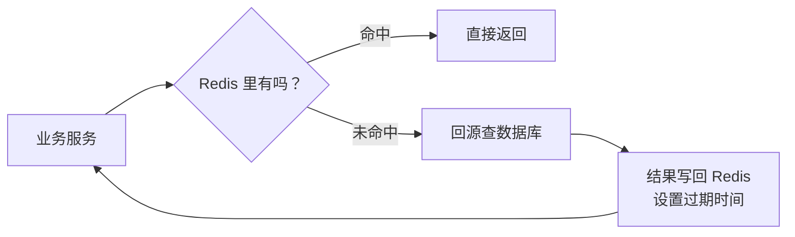

# AGENTS.md

本文件规定本仓库技术科普文章的写作规范。新增或修改 `_posts` 下的文章时，按这里的约定执行，保证多篇文章读起来像同一个作者写的。

## 仓库与发布环境

这是一个 Jekyll 博客，主题为 `jekyll-theme-chirpy`，部署在 GitHub Pages。文章放在 `_posts/`，文件名格式为 `YYYY-MM-DD-短标题.md`。站点配置在 `_config.yml`，文章默认布局、目录、permalink 由 `defaults` 统一指定，正文里不要再写 layout。

## 目标读者

主要读者是 AI 项目的项目经理、产品经理，以及需要快速了解技术全貌的非研发角色。读者不需要会写代码，但要知道一个技术「解决什么问题、大概怎么运转、什么时候该用、什么时候会踩坑」。技术研发也会看，所以内容不能为了通俗而牺牲准确性。

## 单篇文章要回答的问题

- 这个技术是干什么的，一句话怎么解释
- 没有它的时候，项目会碰到什么麻烦
- 它的核心概念和运转方式，用比喻讲清楚
- 它在 AI 项目里通常站在哪个位置
- 它有哪些边界和常见坑
- 项目经理在评审会上应该追问什么

深度控制在概念层：讲原理但不贴大段代码，讲参数但不展开配置细节，讲取舍但不做厂商评测。

## 标题规范

标题要突出技术名，带一点俏皮和悬念，让技术读者愿意点开，但不做与内容不符的标题党。长度控制在 12 到 26 个汉字，避免堆砌感叹号。

可用的句式：

- `技术名：一个……的「比喻」`
- `技术名 不是 XX：……`
- `技术名：……，凭什么……`
- 用反问或轻微吐槽制造钩子

示例：

- `Kafka 不是卡夫卡：一个让数据排队排成顶流的「消息中转站」`
- `Redis：快得离谱、随时失忆，这个「内存小管家」凭什么横着走`

不要用「一文读懂」「万字长文」「全网最全」这类词，也不要在标题里写系列编号。

## Front matter 模板

```yaml
---
title: <标题>
date: YYYY-MM-DD HH:MM
categories: [AI技术, 技术科普]
tags: [<技术名>, <技术类别>, <相关概念>]
description: 写给 AI 项目经理的 <技术名> 概念说明书：<三到四个内容要点>。
mermaid: true
---
```

约定：

- `categories` 固定为 `[AI技术, 技术科普]`，除非用户明确要求另开分类。
- `tags` 三到五个，包含技术名本身。
- `description` 一句话，说清文章覆盖什么，不写营销话术。
- 有 Mermaid 图时必须写 `mermaid: true`，否则图不会渲染。
- 正文不要再用一级标题 `#`，标题由主题从 front matter 渲染，正文从开场段落开始。

## 文章骨架

不要求每篇完全一样，但默认按下面的顺序组织。可以合并或增删小节，不要为了凑结构硬加。

```text
开场：一个具体场景或对话，两段以内
一句话定义：这个技术是什么，英文全称（如果有）
贯穿全文的比喻：只用一个，前后呼应
## 没有它，会怎样 / 它解决什么问题
## 拆开看：核心概念（配架构图）
## 它怎么运转 / 一条数据或请求的旅程（配流程图）
## 它凭什么快 / 稳 / 省（原理，概念级）
## 典型应用场景
## 在 AI 项目里，它站在哪（配应用图）
## 几个容易翻车的认知坑
## 评审会上可以问这几句
## 收个尾
> 一句话带走：……
{: .prompt-tip }
```

开场从真实工作场景切入，比如同事的一句话、一次故障、一个被问住的问题。不要用「随着……的快速发展」「在当今数字化时代」这类开头。

## 段落与排版

正文以段落为主，每段两到五句，长短句交替。用小标题分段，不靠序号推进。需要快速对照的名词或数据结构，可以用一张表格，全文最多一张，控制在四到七行，列名用「名词 / 你可以理解成」这种大白话。

不要把一个完整的意思拆成一串要点。确实需要并列时，用连续的短段落，每段用加粗短语开头，而不是项目符号列表。

中英文之间留一个空格，比如「Redis 的延迟」「Kafka 集群」。中文引号统一用「」，英文专有名词保持原样。全文不使用 emoji。

## 语言风格

像给同事讲东西，不像写白皮书。可以用「你」「我们」，可以调侃，可以承认「这个概念第一次听确实绕」，但不要油腻、不要网络烂梗堆砌。

比喻要具体、可复用。Kafka 是「能倒带的传送带」，Redis 是「会失忆的内存小本本」，同一个比喻贯穿全文，结尾再收一次。不要每段换一个比喻，那会让读者更晕。

术语头一回出现时，给中英文和一句人话解释，比如「消费者组（Consumer Group），一群一起干活的下游程序」。后文直接用中文或英文，不反复括注。

不确定的数字、版本号、性能指标不要写。必须写时，用「通常」「大致」「在常见配置下」限定范围，不写成绝对结论。

## 明确禁止

- 不使用「首先」「其次」「再次」「最后」「第一」「第二」「第三」这类序列词推进文章。「最后」即使表示时间顺序也换成「到头来」「收尾时」等说法。
- 不使用 `1.` `2.` `3.` 形式的有序列表。
- 不在文章里强调与其他文章的关系，不写「上一篇」「下一篇」「上次我们聊了」「继某某之后」。每篇文章必须能独立阅读。
- 不写「众所周知」「不难发现」「显而易见」这类空话。
- 不贴大段代码、配置文件、命令行输出。必要的命令最多一行，用行内代码表示。
- 不做绝对化承诺，比如「保证不丢」「绝对安全」「永久免费」。技术问题一律带条件和取舍。
- 不使用外部图片链接。架构图和流程图用 Mermaid 内嵌。

## Mermaid 图表规范

每篇两到四张图，优先放在「核心概念」「运转流程」「AI 项目位置」三处。图必须承担信息，不能只是把正文换个形式重复一遍。

写法约定：

- 使用 `flowchart LR` 或 `flowchart TB`，方向服从内容，横向放链路，纵向放分层。
- 节点标签一律加引号，节点 ID 用短的 ASCII 字母，比如 `A["生产者"]`。
- 标签内换行用 `<br/>`，不要用 `\n`。
- 标签里避免出现未转义的圆括号、方括号、花括号和竖线，需要时用中文标点或改写措辞。
- 连线标签用 `-->|命中|` 的形式。
- 子图标题也要加引号，比如 `subgraph CLUSTER["Kafka 集群"]`。
- 图前用一句话说明这张图要看什么，图后用一段话解释图里的关键关系，不要让图孤零零地待着。
- 改完图后必须重新构建，确认 Mermaid 代码块被正常输出。

示例：

````markdown

````

## 技术内容要求

概念可以简化，事实不能错。写之前先确认这个技术的定位、核心机制和主要限制，不确定就查资料，不要靠印象编。

几个容易写错、需要特别小心的点：

- 单线程、异步复制、最终一致这类机制，要写清楚限定条件，不能一句「所以不会丢」带过。
- 缓存和存储、消息队列和事件流、批处理和流处理，这些定位差异要明确区分。
- 「精确一次」「高可用」「线性一致」这类词有严格定义，用之前确认语境，必要时补一句边界。
- 性能数字只给量级和条件，不给没有出处的精确值。
- 云厂商产品和开源项目要区分，不把托管服务的特性说成技术本身的特性。

## 项目经理视角

每篇至少有一节「认知坑」和一节「评审问题」。

认知坑写这个技术最容易被误解的地方，以及误解带来的项目风险，比如成本、可靠性、扩展性、运维负担。

评审问题用加粗短语开头，每组一到三个问句，写成连续段落，不用列表。问题要能直接拿去会上问，落在可靠性、容量、一致性、成本、运维归属这些项目经理真正能影响的点上。

示例：

```markdown
**可靠性**：这条链路能接受丢消息吗，能接受重复吗？生产端的确认级别、消费端的重试和幂等，具体做到哪一步？

**容量与积压**：预计峰值每秒多少条，分区数怎么定的？消费积压的报警阈值和扩容方案是什么？
```

## 结尾

用一段话回扣开头的比喻，再给一个可执行的判断标准。最后放一个提示块：

```markdown
> 一句话带走：<不超过 60 字的大白话总结，说清它是什么、适合什么、别拿它干什么>
{: .prompt-tip }
```

## 篇幅

正文两千五到四千字。低于两千字通常讲不透原理和场景，高于四千字项目经理读不完。图表和表格不计入字数。

## 发布前检查

逐项确认后再交付：

- [ ] 文件位于 `_posts/`，命名为 `YYYY-MM-DD-短标题.md`
- [ ] front matter 字段齐全，`categories`、`mermaid` 正确
- [ ] 标题有技术名、有钩子，不是标题党
- [ ] 正文没有一级标题，没有「上一篇」这类跨文章引用
- [ ] 没有「首先 / 其次 / 最后 / 第一 / 第二」等序列词
- [ ] 没有 `1.` `2.` `3.` 有序列表
- [ ] 术语首次出现有解释，比喻前后一致
- [ ] 图表两到四张，标签加引号，图前后都有说明文字
- [ ] 有一节 AI 项目应用场景，有一节认知坑，有一节评审问题
- [ ] 技术表述带条件，没有绝对化承诺
- [ ] 结尾有提示块
- [ ] 执行 `bundle exec jekyll build`，退出码为 0
- [ ] 确认 `_site/posts/<文章名>/index.html` 已生成，且包含 Mermaid 加载脚本

## 微信公众号封面规范

后续给文章配公众号封面，默认使用「等距插画 + 深色科技」风格。除非用户明确要求换风格，不要自行改回扁平卡通、手绘或复古印刷。这个风格的第一份参考实现是 `tools/covers/kafka-cover-isometric.html` 和对应的 `assets/img/covers/kafka-cover-isometric.png`，新封面以它为模板复制修改，保持视觉语言一致。另一份适配「内存小本本」的参考是 `tools/covers/redis-cover-isometric.html` 和 `assets/img/covers/redis-cover-isometric.png`：它把传送带换成了等距书本，并用一只 TTL 沙漏替代人物角色，适合「过期、失忆、计时」这类主题。带人物的旧版保留在 `tools/covers/redis-cover-isometric-character.html`，只作对比，不作为默认参考。

### 尺寸与文件

- 首图固定 900×383 像素，2.35:1，RGB 模式 PNG。
- 次图按需导出 200×200 像素；需要方图时单独出 1:1，不要直接裁首图。
- 成品放在 `assets/img/covers/`，命名 `kafka-cover-isometric.png` 这种「主题-风格.png」格式，或 `<文章slug>-wechat.png`。
- 源文件放在 `tools/covers/`，与成品同名，扩展名 `.html`。`tools/` 在 `_config.yml` 里被排除，不会发布到线上。
- 单张 PNG 控制在 2MB 以内，能压到 500KB 以内更好。公众号后台上传有大小限制，体积过大还会拖慢页面。

### 画面语言

画面左侧放文字，右侧放场景，比例大约是 4:6。文字区不要超过画布一半，插图区要留出呼吸空间。

背景用近黑的深海军蓝，叠一层等距菱形网格、微弱扫描线和青色的环境光。主色固定在青色和珊瑚橙，辅助色用明黄、粉色和奶油白。常用色值：

- 背景 `#050A12`、`#0B1626`
- 青色 `#4DE1FF`、`#8FE3FF`
- 珊瑚橙 `#FF6B35`、`#E4572E`
- 明黄 `#FFD166`、粉色 `#FF8FAB`、奶油白 `#FFF7EC`

插图必须是 45 度等距视角，用菱形的顶面、侧面和厚度表现体积，不要画成平面俯视图。传送带、数据方块、悬浮标签、无人机或小机器人、终端风格的对话气泡、虚线回放箭头，这些元素可以按主题替换。默认保留「一个承载数据的结构 + 两到四个数据单元 + 一个拟人化角色或一个强符号」。如果主题有比人物更直白的符号，比如 Redis 的 TTL 沙漏，就用符号做视觉中心，不强行加人物。需要角色时保持 Q 版比例，头和身体接近 1:1，别画写实人体。

数据方块用深色填充配霓虹描边，标签用悬浮胶囊，用虚线连到方块。传送带或其他承载结构要有青色描边和橙色边条，下方加一层柔光。整个场景允许轻微悬浮，不必画支架和地面。

### 文字区

左侧从上到下依次放：身份标签、主标题、否定式副标题、一句话说明、三个关键词标签、账号署名。

主标题就是技术名，例如 `KAFKA`，字号 80 到 92 像素，Arial Black，白色到浅青的渐变填充，背后叠一层珊瑚橙偏移和一层青色模糊光晕。技术名超过八个字母时缩小字号，保证不压到插图区。

副标题用「不是 XX」或一句反问，放在描边或实底的深色框里，字号 30 到 34 像素，中文字体用微软雅黑。说明文字 20 到 21 像素，浅灰蓝色。关键词标签三个，14 像素，深色底加青色描边。署名 12 像素，放左下角，写「黑胶先生 · 把技术讲成人话」。

文字颜色只用奶油白、浅青和浅灰蓝，不要在主标题上使用低对比度的深色。所有文字距离画布边缘至少 32 像素。主标题、副标题和说明文字不能互相重叠。

### 内容要求

封面文案可以比文章标题更短，但要保留技术名和核心比喻。标题里不要出现「一文读懂」「全网最全」这类词，也不要把文章里的长句直接搬上来。

画面上最多出现一个主标题、一个副标题、一句说明、三个关键词，以及两到四个数据单元标签。不要在封面里塞架构说明、参数或大段解释。

插图要能对应文章的核心比喻。Kafka 用传送带，Redis 可以用小本本或高速缓存仓，消息队列用分拣线，模型服务用流水线。风格固定，场景可以换。

避免使用厂商 Logo、受商标保护的产品图标和真实人物肖像。技术名用文字排版表现，不要直接贴官方 Logo。

### 渲染流程

封面不用 AI 绘图模型，统一用 HTML/SVG 手写，再用无头 Edge 导出 PNG。流程如下：

1. 从 `tools/covers/kafka-cover-isometric.html` 复制一份，改名为新主题，保留画布、配色、字体和布局骨架。
2. 修改标题、副标题、说明文字、数据单元标签和场景元素。坐标尽量沿用原模板，新增元素不要超出 32 像素安全边距。
3. 用下面的命令导出，路径必须是绝对路径：

```bash
"/c/Program Files (x86)/Microsoft/Edge/Application/msedge.exe" \
  --headless=new --disable-gpu --hide-scrollbars \
  --force-device-scale-factor=1 --no-first-run --no-default-browser-check \
  --disable-extensions \
  --user-data-dir="C:/Users/Administrator/AppData/Local/Temp/edge-cover-profile" \
  --window-size=900,383 \
  --screenshot="C:/Users/Administrator/Documents/WebSite/cesarwu410.github.io/assets/img/covers/<名称>.png" \
  "file:///C:/Users/Administrator/Documents/WebSite/cesarwu410.github.io/tools/covers/<名称>.html"
```

4. 用图片查看工具打开导出的 PNG，确认没有文字裁切、元素重叠、字体回退和边缘越界，再交付。
5. 需要调整时只改 HTML 源文件重新导出，不要直接编辑 PNG。

### 封面自检

- [ ] 画布 900×383，PNG，RGB
- [ ] 等距视角，深色科技配色，青色和珊瑚橙为主
- [ ] 左侧文字区、右侧场景区，文字距离边缘至少 32 像素
- [ ] 主标题、副标题、说明文字在缩略图下仍然可读
- [ ] 数据单元标签没有被角色、沙漏、传送带等主体元素遮挡
- [ ] 没有厂商 Logo、真实人物肖像和外部图片链接
- [ ] 文件体积在 2MB 以内
- [ ] 源文件在 `tools/covers/`，成品在 `assets/img/covers/`
- [ ] 已实际查看导出结果，没有裁切、重叠和字体异常

如果公众号的展示位可能裁成 1:1，额外导出一版 200×200 或 900×900。不要把 2.35:1 的首图直接裁切交付，标题和场景很容易被切掉。

## 微信公众号文章排版

公众号正文模板放在 `tools/wechat/`，完整样式规范见 `tools/wechat/STYLE.md`。当用户要求生成公众号文章或排版时，默认直接复用这套规范，不要重新设计版式。流程：

1. 照常写 `_posts/*.md`，需要图表时继续用 Mermaid。
2. 执行 `bundle exec jekyll build`。
3. 执行 `python tools/wechat/convert.py "<文章 slug>"`。
4. 打开 `tools/wechat/output/<slug>/preview.html`，先看 677px 和 375px 两种宽度。
5. 点「复制正文」粘贴到公众号编辑器，上传 `images/` 里的图片，再用手机预览确认。如果复制后只剩纯文字，用 `python tools/wechat/serve.py "<slug>"` 通过 localhost 打开预览，再点复制。

可选 front matter `wechat` 支持 `lead`、`kickers`、`cards`，具体见 `tools/wechat/README.md`。文章标准的 `description` 会自动放在公众号正文最上方，渲染成红色描边、透明填充、外发光的卡片，正文 14px 加粗 / 1.6 行高。正文结束后会自动追加居中的「END」分割线。Mermaid 图会自动导出 PNG；横向特别长的图会在图下加「点击图片查看大图」。公众号会清洗部分样式，表格、代码卡片和图片宽度以手机预览为准。`tools/` 已被 `_config.yml` 排除，不会发布到博客。

## 修改已有文章时

尊重作者在磁盘上的手动修改，不要因为与规范不一致就整段回退。只改用户点名的问题，顺带修复同一段里明显的错别字或事实错误。改完重新构建，并在回复里说明改了哪里。
