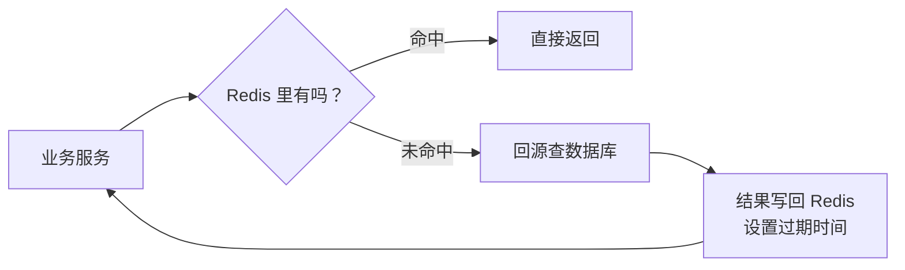

# AGENTS.md

本文件规定本仓库技术科普文章的写作规范。新增或修改 `_posts` 下的文章时，按这里的约定执行，保证多篇文章读起来像同一个作者写的。

## 仓库与发布环境

这是一个 Jekyll 博客，主题为 `jekyll-theme-chirpy`，部署在 GitHub Pages。文章放在 `_posts/`，文件名格式为 `YYYY-MM-DD-短标题.md`。站点配置在 `_config.yml`，文章默认布局、目录、permalink 由 `defaults` 统一指定，正文里不要再写 layout。

## 目标读者

主要读者是 AI 项目的项目经理、产品经理，以及需要快速了解技术全貌的非研发角色。读者不需要会写代码，但要知道一个技术「解决什么问题、大概怎么运转、什么时候该用、什么时候会踩坑」。技术研发也会看，所以内容不能为了通俗而牺牲准确性。

## 单篇文章要回答的问题

- 这个技术是干什么的，一句话怎么解释
- 没有它的时候，项目会碰到什么麻烦
- 它的核心概念和运转方式，用比喻讲清楚
- 它在 AI 项目里通常站在哪个位置
- 它有哪些边界和常见坑
- 项目经理在评审会上应该追问什么

深度控制在概念层：讲原理但不贴大段代码，讲参数但不展开配置细节，讲取舍但不做厂商评测。

## 标题规范

标题要突出技术名，带一点俏皮和悬念，让技术读者愿意点开，但不做与内容不符的标题党。长度控制在 12 到 26 个汉字，避免堆砌感叹号。

可用的句式：

- `技术名：一个……的「比喻」`
- `技术名 不是 XX：……`
- `技术名：……，凭什么……`
- 用反问或轻微吐槽制造钩子

示例：

- `Kafka 不是卡夫卡：一个让数据排队排成顶流的「消息中转站」`
- `Redis：快得离谱、随时失忆，这个「内存小管家」凭什么横着走`

不要用「一文读懂」「万字长文」「全网最全」这类词，也不要在标题里写系列编号。

## Front matter 模板

```yaml
---
title: <标题>
date: YYYY-MM-DD HH:MM
categories: [AI技术, 技术科普]
tags: [<技术名>, <技术类别>, <相关概念>]
description: 写给 AI 项目经理的 <技术名> 概念说明书：<三到四个内容要点>。
mermaid: true
---
```

约定：

- `categories` 固定为 `[AI技术, 技术科普]`，除非用户明确要求另开分类。
- `tags` 三到五个，包含技术名本身。
- `description` 一句话，说清文章覆盖什么，不写营销话术。
- 有 Mermaid 图时必须写 `mermaid: true`，否则图不会渲染。
- 正文不要再用一级标题 `#`，标题由主题从 front matter 渲染，正文从开场段落开始。

## 文章骨架

不要求每篇完全一样，但默认按下面的顺序组织。可以合并或增删小节，不要为了凑结构硬加。

```text
开场：一个具体场景或对话，两段以内
一句话定义：这个技术是什么，英文全称（如果有）
贯穿全文的比喻：只用一个，前后呼应
## 没有它，会怎样 / 它解决什么问题
## 拆开看：核心概念（配架构图）
## 它怎么运转 / 一条数据或请求的旅程（配流程图）
## 它凭什么快 / 稳 / 省（原理，概念级）
## 典型应用场景
## 在 AI 项目里，它站在哪（配应用图）
## 几个容易翻车的认知坑
## 评审会上可以问这几句
## 收个尾
> 一句话带走：……
{: .prompt-tip }
```

开场从真实工作场景切入，比如同事的一句话、一次故障、一个被问住的问题。不要用「随着……的快速发展」「在当今数字化时代」这类开头。

## 段落与排版

正文以段落为主，每段两到五句，长短句交替。用小标题分段，不靠序号推进。需要快速对照的名词或数据结构，可以用一张表格，全文最多一张，控制在四到七行，列名用「名词 / 你可以理解成」这种大白话。

不要把一个完整的意思拆成一串要点。确实需要并列时，用连续的短段落，每段用加粗短语开头，而不是项目符号列表。

中英文之间留一个空格，比如「Redis 的延迟」「Kafka 集群」。中文引号统一用「」，英文专有名词保持原样。全文不使用 emoji。

## 语言风格

像给同事讲东西，不像写白皮书。可以用「你」「我们」，可以调侃，可以承认「这个概念第一次听确实绕」，但不要油腻、不要网络烂梗堆砌。

比喻要具体、可复用。Kafka 是「能倒带的传送带」，Redis 是「会失忆的内存小本本」，同一个比喻贯穿全文，结尾再收一次。不要每段换一个比喻，那会让读者更晕。

术语头一回出现时，给中英文和一句人话解释，比如「消费者组（Consumer Group），一群一起干活的下游程序」。后文直接用中文或英文，不反复括注。

不确定的数字、版本号、性能指标不要写。必须写时，用「通常」「大致」「在常见配置下」限定范围，不写成绝对结论。

## 明确禁止

- 不使用「首先」「其次」「再次」「最后」「第一」「第二」「第三」这类序列词推进文章。「最后」即使表示时间顺序也换成「到头来」「收尾时」等说法。
- 不使用 `1.` `2.` `3.` 形式的有序列表。
- 不在文章里强调与其他文章的关系，不写「上一篇」「下一篇」「上次我们聊了」「继某某之后」。每篇文章必须能独立阅读。
- 不写「众所周知」「不难发现」「显而易见」这类空话。
- 不贴大段代码、配置文件、命令行输出。必要的命令最多一行，用行内代码表示。
- 不做绝对化承诺，比如「保证不丢」「绝对安全」「永久免费」。技术问题一律带条件和取舍。
- 不使用外部图片链接。架构图和流程图用 Mermaid 内嵌。

## Mermaid 图表规范

每篇两到四张图，优先放在「核心概念」「运转流程」「AI 项目位置」三处。图必须承担信息，不能只是把正文换个形式重复一遍。

写法约定：

- 使用 `flowchart LR` 或 `flowchart TB`，方向服从内容，横向放链路，纵向放分层。
- 节点标签一律加引号，节点 ID 用短的 ASCII 字母，比如 `A["生产者"]`。
- 标签内换行用 `<br/>`，不要用 `\n`。
- 标签里避免出现未转义的圆括号、方括号、花括号和竖线，需要时用中文标点或改写措辞。
- 连线标签用 `-->|命中|` 的形式。
- 子图标题也要加引号，比如 `subgraph CLUSTER["Kafka 集群"]`。
- 图前用一句话说明这张图要看什么，图后用一段话解释图里的关键关系，不要让图孤零零地待着。
- 改完图后必须重新构建，确认 Mermaid 代码块被正常输出。

示例：

````markdown

````

## 技术内容要求

概念可以简化，事实不能错。写之前先确认这个技术的定位、核心机制和主要限制，不确定就查资料，不要靠印象编。

几个容易写错、需要特别小心的点：

- 单线程、异步复制、最终一致这类机制，要写清楚限定条件，不能一句「所以不会丢」带过。
- 缓存和存储、消息队列和事件流、批处理和流处理，这些定位差异要明确区分。
- 「精确一次」「高可用」「线性一致」这类词有严格定义，用之前确认语境，必要时补一句边界。
- 性能数字只给量级和条件，不给没有出处的精确值。
- 云厂商产品和开源项目要区分，不把托管服务的特性说成技术本身的特性。

## 项目经理视角

每篇至少有一节「认知坑」和一节「评审问题」。

认知坑写这个技术最容易被误解的地方，以及误解带来的项目风险，比如成本、可靠性、扩展性、运维负担。

评审问题用加粗短语开头，每组一到三个问句，写成连续段落，不用列表。问题要能直接拿去会上问，落在可靠性、容量、一致性、成本、运维归属这些项目经理真正能影响的点上。

示例：

```markdown
**可靠性**：这条链路能接受丢消息吗，能接受重复吗？生产端的确认级别、消费端的重试和幂等，具体做到哪一步？

**容量与积压**：预计峰值每秒多少条，分区数怎么定的？消费积压的报警阈值和扩容方案是什么？
```

## 结尾

用一段话回扣开头的比喻，再给一个可执行的判断标准。最后放一个提示块：

```markdown
> 一句话带走：<不超过 60 字的大白话总结，说清它是什么、适合什么、别拿它干什么>
{: .prompt-tip }
```

## 篇幅

正文两千五到四千字。低于两千字通常讲不透原理和场景，高于四千字项目经理读不完。图表和表格不计入字数。

## 发布前检查

逐项确认后再交付：

- [ ] 文件位于 `_posts/`，命名为 `YYYY-MM-DD-短标题.md`
- [ ] front matter 字段齐全，`categories`、`mermaid` 正确
- [ ] 标题有技术名、有钩子，不是标题党
- [ ] 正文没有一级标题，没有「上一篇」这类跨文章引用
- [ ] 没有「首先 / 其次 / 最后 / 第一 / 第二」等序列词
- [ ] 没有 `1.` `2.` `3.` 有序列表
- [ ] 术语首次出现有解释，比喻前后一致
- [ ] 图表两到四张，标签加引号，图前后都有说明文字
- [ ] 有一节 AI 项目应用场景，有一节认知坑，有一节评审问题
- [ ] 技术表述带条件，没有绝对化承诺
- [ ] 结尾有提示块
- [ ] 执行 `bundle exec jekyll build`，退出码为 0
- [ ] 确认 `_site/posts/<文章名>/index.html` 已生成，且包含 Mermaid 加载脚本

## 修改已有文章时

尊重作者在磁盘上的手动修改，不要因为与规范不一致就整段回退。只改用户点名的问题，顺带修复同一段里明显的错别字或事实错误。改完重新构建，并在回复里说明改了哪里。
