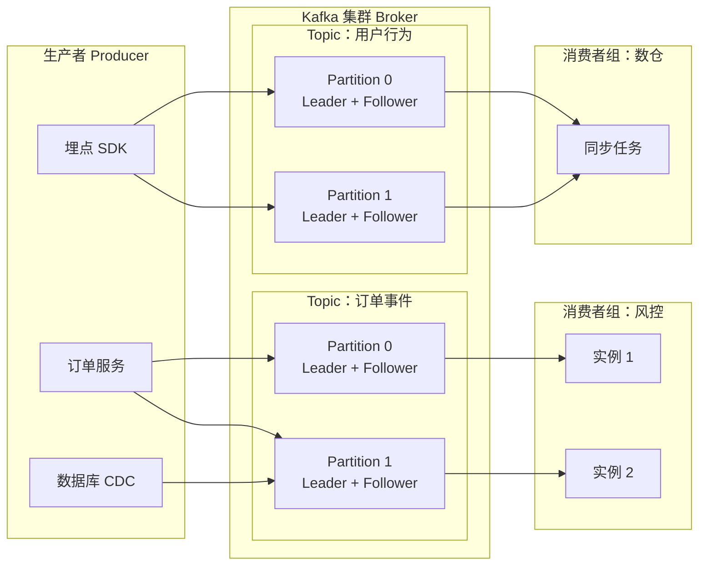
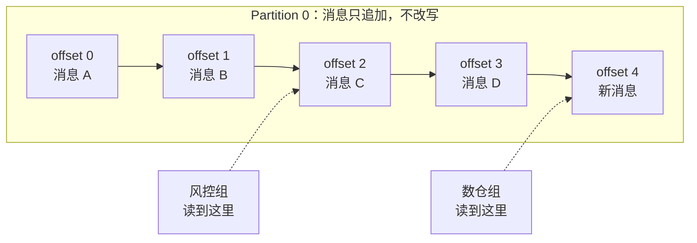
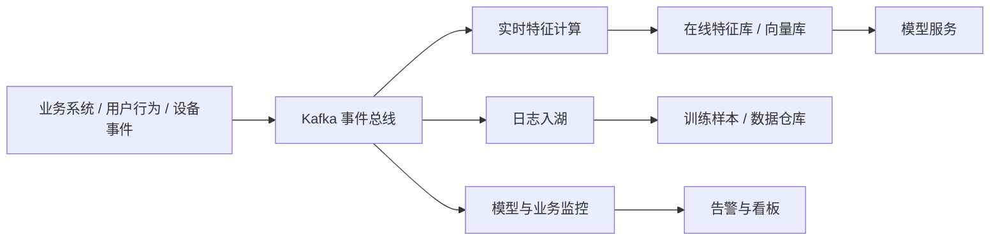

项目例会上，后端同学轻描淡写地说了一句「这个链路加个 Kafka 就行了」，你点点头，心里却在犯嘀咕：卡夫卡不是写《变形记》的那位作家吗，怎么跑来我们系统里打工了？

还真有点关系。Kafka 的名字就是创始人 Jay Kreps 取的，理由是这玩意儿是一个「为写作而优化」的系统，配一个以写作闻名的作家，挺合理。只不过作家写的是小说，Kafka 写的是消息。

你可以先记住一个画面：**它是一条特别长、特别能扛、还可以倒回去重看的传送带**。业务系统把事件扔上传送带，下游想什么时候取、取几份、从哪个位置开始取，都随它。接下来把这幅画面拆开，看看它凭什么成了大数据和 AI 项目里的常驻嘉宾。

## 没有它，系统之间会怎样互相折磨

最原始的玩法是接口直连。订单服务处理完订单，顺手调一下风控接口，再调一下积分接口，再调一下推荐接口。平时看着挺顺，一到双十一就原形毕露：积分服务慢了一秒，订单服务跟着卡一秒；推荐服务挂了，订单也提交不了。明明只是「通知一声」的事，硬是变成了「同生共死」。

Kafka 干的活，就是在这中间插一条缓冲带。订单服务只管把「订单已创建」这件事扔进去，至于谁来消费、消费多快、挂没挂，跟它没关系。这就是大家常说的**解耦**。

缓冲带还顺手解决了**削峰**。中午十二点大家一齐下单，流量像早高峰的地铁；下游处理能力就那么多，硬扛只会被打穿。消息先堆在 Kafka 里，下游按自己的节奏慢慢消化，峰值被摊平成了长尾。对项目经理来说，这意味着你不必为了那十分钟的峰值，把整个下游扩容十倍。

还有**异步**。用户点了「提交」，页面立刻返回成功，后面的发券、发短信、更新报表慢慢做。体验上快了一大截，系统之间也不用互相等待。

## 拆开看：Kafka 的户口本

先上一张全景图，后面所有名词都能在这张图里找到位置。

图里这些角色，用大白话翻译一遍就够了。

| 名词 | 你可以理解成 |
| --- | --- |
| Producer（生产者） | 往传送带上放东西的人，通常是业务服务、埋点 SDK、数据库同步工具 |
| Broker | 一台台存消息的服务器，几台凑在一起就是 Kafka 集群 |
| Topic（主题） | 传送带上的分类标签，比如「订单事件」「用户行为」，不同业务各走各的道 |
| Partition（分区） | 一个 Topic 被切成好几条并行的子传送带，是 Kafka 扩容和并行的基本单位 |
| Offset（偏移量） | 每条消息在自己分区里的序号，像书页页码，消费者靠它记住读到哪儿了 |
| Consumer Group（消费者组） | 一群一起干活的下游程序，组内分工，组与组之间互不影响 |
| Replica（副本） | 分区的备份，Leader 干活，Follower 跟着抄，机器挂了有人顶上 |

这里最容易被忽略、但对项目影响最大的是 **Partition**。它决定了并行度，也决定了钱。分区越多，能同时消费的实例越多，但每个分区都有副本、有文件句柄、有元数据开销，不是越多越好。很多线上事故不是 Kafka 本身不行，而是当初分区数拍脑袋定的。

## 一条消息的旅行

消息进了 Kafka 之后，待遇和传统队列很不一样。它不是「被读走就删除」，而是**追加写入、静静躺着、按保留策略过期**。

生产者把消息写到分区尾部，消费者则拿着自己的 offset 往前读。读完不会删，只是 offset 往前挪。于是有了一个传统队列很难做到的能力：**回放**。新上线的推荐模型想拿过去七天的用户行为重新跑一遍，把 offset 调回去就行；某个下游程序写错了数据，也能重读同一批消息修复，不必求上游再发一遍。

消息进哪个分区，通常由消息的 key 决定，相同 key 落到同一分区。这也带来一个必须记住的约束：**Kafka 只保证单个分区内的顺序，不保证整个 Topic 的全局顺序**。所以「下单」和「支付」的先后关系，得靠业务上把相关消息塞进同一个 key，而不是指望 Kafka 自动帮你排队。

## 它凭什么快

很多人头一回听到「Kafka 用磁盘存消息还能扛百万级吞吐」都会愣一下，毕竟磁盘在直觉里是慢的。它的快不是靠堆硬件，而是把几件朴素的事做到了极致。

写消息是纯追加，永远往文件末尾写，不回头改，磁盘磁头不用来回找位置，这叫顺序写。操作系统本来就有一层页缓存，Kafka 大量利用它，热数据基本在内存里转。发送端还会把消息攒一批再发，顺带压缩，网络和磁盘的利用率都上去了。真正传数据给消费者时，它尽量让数据从磁盘直接送到网卡，少在用户态来回拷贝，也就是常说的零拷贝。

再加上分区天然并行，一个 Topic 的吞吐可以横向摊到多台机器上。这套组合拳下来，单机几万到几十万条每秒并不稀奇，规模大的公司做到百万级也常见。对项目经理来说，结论比原理重要：**Kafka 的吞吐上限很高，但前提是分区规划、批量参数、压缩策略这些工程细节做到位**，不是装上去就自动快。

## 不丢消息这件事，它是怎么做到的

这是评审会上最该关心的问题，也是最容易被一句「Kafka 很可靠」糊弄过去的地方。

Kafka 的每个分区都有副本，一主多从。生产者可以配置确认级别：消息写到主副本就算成功，还是必须等所有同步副本都收到才算成功。后者更安全，但延迟更高。集群里还会维护一个「跟得上进度的副本名单」，主副本挂了，只有名单里的副本才有资格接班，避免一个落后很多的副本上位把数据带丢。

这套机制保证的是「Kafka 内部不丢」。消息出了 Kafka 之后，下游消费失败、重复消费、写库写一半挂了，仍然要靠业务自己做重试和幂等。Kafka 提供了幂等生产者和事务能力，可以做到「Kafka 这一段的精确一次」，但端到端的精确一次，得整条链路一起配合。听到有人说「我们用了 Kafka，所以不会重复」，基本可以追一句：那消费端怎么去重？

## 消费者组：一份数据，多拨人各看各的

消费者组是 Kafka 很妙的一个设计。同一个组里的多个实例自动分工，一个分区同一时刻只会被组里的一个实例消费，所以加机器就能提速，实例挂了也会自动重新分配。不同组之间则完全独立，各自维护自己的 offset，互不干扰。

于是同一份订单事件，风控组可以实时算风险，数仓组可以慢慢同步，推荐组可以拿去更新特征，三拨人看的是同一份数据，谁也不耽误谁。这也是 Kafka 跟传统「一条消息只能被一个消费者拿走」的队列最大的区别之一。

代价是运维上多了一个关键指标：**消费积压**，也就是消费者当前进度和生产进度的差距。积压持续上涨，要么是下游处理不过来，要么是分区数不够扩不了实例，要么是某条消息把消费线程卡死了。这个指标比「Kafka 有没有挂」更值得放进监控大盘。

## AI 项目里，Kafka 一般站在哪

放到 AI 项目里，Kafka 很少是主角，但经常是那条贯穿始终的管道。

做 RAG 的时候，文档上传、解析、切块、向量化往往是一条异步流水线，Kafka 负责把「有新文档了」这件事稳稳地传给后面的处理工人，某个环节挂了还能重放。做推荐和风控的时候，用户行为实时进 Kafka，特征计算任务从里面取数，算完写进在线特征库。做模型监控的时候，每次推理的输入输出、延迟、反馈事件也可以先落 Kafka，再分别流向看板和离线分析。

它的价值不在「智能」，而在**把智能所需要的数据，稳定、可回放、可扩容地送到该去的地方**。模型会换、框架会换，这条管道往往活得比模型还久。

## Kafka 不是万能药：几个常见的认知坑

它是传送带，不是数据库。你可以按 offset 顺序读，但不能像 SQL 那样按条件查「昨天所有金额大于一百的订单」。需要查询，得把数据导到数仓、ClickHouse 或者别的存储里。

它也不适合请求响应。让两个服务通过 Kafka 一问一答，等于用货运火车送一封快递，延迟和复杂度都不划算。那种场景 Redis、gRPC 或者普通的消息队列更合适。

顺序只在分区内成立，前面已经提过，但值得再强调一次，因为它经常在需求评审时被想当然地忽略。消息体也别太大，几个 MB 的图片视频往里塞，会把整条管道的吞吐拖垮，通常的做法是消息里只放对象存储的地址。

还有成本。自建集群要人运维、要磁盘、要监控、要演练故障切换；云上的托管 Kafka 省心，但账单会跟着流量和保留时长走。数据保留七天和保留三个月，磁盘成本可能是几倍的差距。这些都不是技术细节，是项目预算。

## 作为项目经理，评审会上可以问这几句

**可靠性**：这条链路能接受丢消息吗，能接受重复吗？生产端的确认级别、消费端的重试和幂等，具体做到哪一步？

**容量与积压**：预计峰值每秒多少条，分区数怎么定的？消费积压的报警阈值和扩容方案是什么？

**顺序与分区**：业务上有没有先后依赖，key 怎么选，会不会出现某个 key 特别热、全压在一个分区上？

**保留与成本**：消息留多久，磁盘或云账单大概什么量级，有没有冷热分层的打算？

**运维归属**：集群是自建还是托管，出了故障谁值班，有没有做过 Broker 宕机和机房级故障的演练？

**选型必要性**：这个体量真的需要 Kafka 吗，还是 RabbitMQ、Redis Stream、云消息队列更合适？技术选型没有标准答案，只有匹配不匹配。

## 收个尾

Kafka 的故事其实很朴素：把系统之间「你必须现在处理」的强耦合，换成「先放这儿，待会儿再说」的缓冲。它用追加写、分区、副本和消费者组，把这件朴素的事做到了工业级规模。理解了传送带这个画面，再听到 offset、分区、积压这些词，你就不会被绕进去。

下次后端同学再说「加个 Kafka 就行了」，你可以淡定地接一句：行，那条可以倒带的传送带是吧，分区和保留策略给我看一下。

> 一句话带走：Kafka 不是数据库，也不是万能消息总线，它是一条高吞吐、可回放、能横向扩容的事件传送带，价值在于让数据流动这件事变得可靠又便宜。
{: .prompt-tip }
