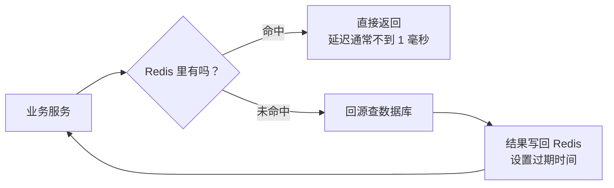
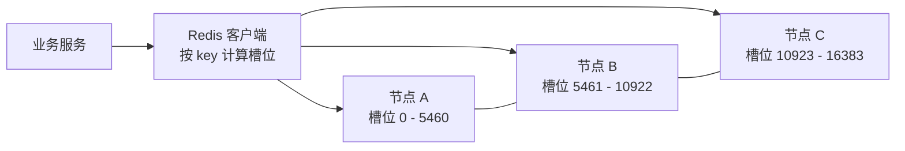
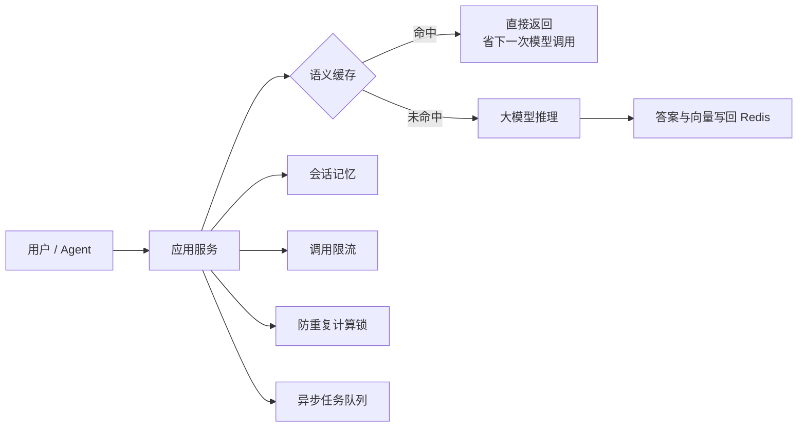

后端同学说「这个接口加个 Redis 缓存」的时候，翻译过来通常是：它现在太慢了，慢到用户已经开始敲桌子。于是你去看架构图，发现 Redis 这个名字几乎无处不在：登录态、排行榜、接口限流、任务队列，好像什么都能往里塞。它到底是个什么东西，又凭什么哪儿都有它？

Redis 的全名是 Remote Dictionary Server，直译过来就是「远程字典服务」。名字听着朴素，干的事也不复杂：把数据放在内存里，用一堆现成的数据结构帮你摆好，需要的时候一伸手就能拿到。但就是这么个朴素的东西，常年霸占后端技术栈的「最受欢迎奖」。

## 先说人话：它就是个住在内存里的「万能小本本」

普通数据库把数据放在磁盘上，查一次要走一趟文件系统，慢是物理规律。Redis 把数据放在内存里，内存的读写速度比磁盘快几个数量级，所以它的延迟通常在亚毫秒到毫秒之间。快，是它所有故事的起点。

它和早期的 Memcached 最大的区别，是它不只存字符串。你可以把它理解成一个带分格的抽屉，每个格子里放什么类型的数据，它都管。

| 数据结构 | 你可以当成 | 常见用法 |
| --- | --- | --- |
| String | 一个能存文本或数字的格子 | 缓存对象、计数器、分布式锁 |
| Hash | 一个带标签的小抽屉 | 用户资料、购物车、配置项 |
| List | 一份可以两头进出的名单 | 简单队列、最新动态、消息流 |
| Set | 自动去重的集合 | 标签、关注关系、抽奖池 |
| Sorted Set | 带分数的排行榜 | 排行榜、延时队列、优先级队列 |
| Stream | 一本带编号的流水账 | 轻量消息队列、事件消费 |

再冷门一点的还有 Bitmap、HyperLogLog、Geo，分别用来做签到统计、海量去重计数和附近的人。这些结构带来的便利是：很多功能不用再建表、写 SQL、加索引，几行命令就能跑起来。代价是，用错结构的时候，内存会以一种让你心疼的速度消失。

## 为什么快得这么不讲道理

内存是一方面，但只靠内存解释不了 Redis 为什么能扛住几十万 QPS。它把「少做无用功」这件事贯彻得相当彻底。

处理命令的核心线程是单线程的。听起来像个缺点，实际上是个妙招：没有多线程锁竞争，没有上下文切换，每条命令天然就是原子操作，代码简单到不容易出并发 bug。网络收发在较新的版本里可以用多线程分担，但真正执行命令的那一段，还是老老实实排队。

它还用了一套高效的事件循环，一个线程就能同时盯着成千上万个连接，谁有数据就处理谁，不会傻等。加上协议设计得足够简单、数据结构的实现足够紧凑，单机跑出十万级 QPS 并不稀奇。

单线程也意味着一个必须记住的副作用：**一条慢命令会堵住所有人**。像 `KEYS *` 这种全量扫描、几百万字段的大 Hash 一次性删除、写得太久的 Lua 脚本，都可能让整个实例卡住几百毫秒甚至更久。很多「Redis 突然变慢」的线上事故，根子都在这里。

## 它不只是缓存：小本本的几份副业

缓存是 Redis 最出名的身份，但它兼职多得惊人。

**会话存储**是最常见的一种。用户登录后的 session 放在 Redis 里，几台应用服务器都能读到，用户请求落到哪台机器都不影响，扩容和重启也丢不了登录态。

**分布式锁**也常找它。多个实例抢同一个任务时，用一条「不存在才写入」的命令加过期时间，谁写成功谁拿锁。简单、够快，适合大多数「防止重复干活」的场景。但它不是强一致的银弹，后面会细说。

**限流**靠它做计数器很顺手。给每个用户或每个接口一个 key，单位时间内自增，超过阈值就拒绝。用 Lua 脚本把「读、判断、写」打包成原子操作，几行代码就是一个令牌桶。

**排行榜**是 Sorted Set 的主场。游戏积分、热搜榜、直播间人气，写入时带个分数，读取时按分数排序，天然支持区间查询和实时更新。

**简单队列**也能凑合。List 可以从一头进另一头出，Stream 还带消费组和确认机制。体量不大的异步任务，用它比 Kafka 轻便得多。

**计数器与统计**更是顺手。文章阅读数、接口调用量、日活去重，用 String 自增或者 HyperLogLog，成本低到可以忽略。

也正因为什么都能干，Redis 很容易变成团队里的「瑞士军刀」。好处是开发快，坏处是所有人都往里面塞东西，到头来没人说得清哪块内存是谁的。

## 缓存这件事，坑比想象中多

最常见的用法是「旁路缓存」：读的时候先问 Redis，有就直接返回，没有就查数据库，再把结果写回 Redis 并设个过期时间。

看着挺简单，真正上线后，麻烦基本集中在三个地方。

**缓存穿透**，指的是有人一直查一个根本不存在的数据。Redis 里没有，请求就全砸到数据库上；数据库也没有，下次再来还是同样的剧本。恶意攻击或者代码 bug 都能触发。常见的挡法是缓存空值，或者前面加一层布隆过滤器。

**缓存击穿**，指的是某个被高频访问的热 key 刚好过期，一瞬间所有请求同时回源。就像整栋楼的人同时挤向一部刚修好的电梯。解法通常是给回源加互斥锁，只放一个请求去查库，其他的等结果；或者用逻辑过期，让旧数据多撑一会儿。

**缓存雪崩**，指的是大批 key 在同一时间集中过期，或者 Redis 整个挂了，流量像雪崩一样压到数据库。给过期时间加随机抖动、做多级缓存、给数据库加熔断限流，都是常见防线。

还有一致性问题。数据库更新了，缓存里的旧值什么时候失效？常见做法是先更新数据库，再删除缓存，必要时延迟再删一次。这套方案能覆盖绝大多数场景，但它是最终一致，不是实时一致。如果业务要求「刚写完立刻读到新值」，那得在设计阶段就说清楚，别等上线后靠加机器硬扛。

## 内存不是白来的：持久化和淘汰

Redis 是内存数据库，但内存断电就没了，所以它提供了两种持久化方式。

RDB 是拍快照，隔一段时间把内存里的数据整个写到磁盘，文件紧凑，恢复快，适合做备份。缺点是两次快照之间的数据会丢，而且拍快照时 fork 子进程，内存大的实例会出现短暂卡顿。

AOF 是记流水账，每条写命令都追加到日志里，重启时重放。它更接近实时，丢的数据少，但文件更大，恢复更慢。常见的配置是每秒刷一次盘，极端情况下会丢掉最近一秒左右的写入。

新版本还支持两者混用，先用 RDB 打底，再用 AOF 补增量，兼顾恢复速度和数据完整度。但不管怎么配，Redis 的持久化都不是为了替代数据库。**把它当唯一存储，等于把身家性命押在一个以快为卖点的系统上**，真出事的时候，恢复点和恢复时间都很难给业务一个硬承诺。

内存有限，还得决定「满了怎么办」。Redis 提供了多种淘汰策略：不淘汰直接报错、按最近最少使用淘汰、按访问频率淘汰、随机淘汰、只淘汰设了过期时间的 key。选哪种，取决于你把 Redis 当缓存还是当存储。当缓存，通常允许淘汰冷数据；当存储，就得留足内存并且接受写入失败的可能。

## 一台不够就多台：主从、哨兵、集群

单机再快也有上限，机器挂了更是直接归零。Redis 的扩展路线分两层。

主从复制解决读扩展和备份。主节点负责写，从节点异步复制，读请求可以分摊到从节点。异步意味着主节点写完就返回，从节点可能还没收到，主节点这时候挂了，没同步过去的数据就丢了。对缓存来说通常无所谓，对账本类数据就是事故。

哨兵解决高可用。几个哨兵进程盯着主从集群，主节点失联时投票选一个新主，通知客户端切换。它管的是「别挂太久」，不管「数据装不下」。

数据装不下就得上集群。Redis Cluster 把整个键空间切成 16384 个槽位，分给多个主节点，每个主节点再带从节点。

客户端根据 key 算出槽位，直接连对应的节点，省掉一层代理。集群模式也有代价：跨多个 key 的操作会受限，事务和 Lua 脚本要求涉及的 key 落在同一个槽里。工程上会用 hash tag 把相关 key 强行绑到一个槽，但这属于设计阶段就要想清楚的事，不是上线后拍脑袋能补的。

## Redis 和 Kafka，别再把它们混着用

这两个东西经常一起出现在架构图里，但定位完全不同。

Kafka 是把消息持久化到磁盘的日志，能存很久、能回放、能扛极高的吞吐，代价是延迟在毫秒到几十毫秒级别，运维也更重。Redis 是把数据放在内存里的快手，延迟低到亚毫秒，但内存贵、容量有限、持久化保证弱。

所以常见分工是：Kafka 负责「这件事发生过，不能丢，后面还要重放」，Redis 负责「这个结果很热，先放这儿，下一秒可能就不用了」。用 Redis 的 List 或 Stream 做轻量队列没问题，但拿它替代 Kafka 去做大规模事件总线，通常会在内存成本和可靠性上付出代价。

## AI 项目里，Redis 通常蹲在哪个角落

放到 AI 项目里，Redis 很少站在聚光灯下，但它出现的频率高得惊人。

大模型调用又贵又慢，很多团队会在前面加一层缓存。简单的问题按原文哈希命中，复杂一点的上语义缓存：把问题转成向量，在 Redis 里做相似度检索，命中相似问题就直接返回旧答案。省下的是真金白银和用户等待时间。

Agent 的会话记忆也常放这里。多轮对话的上下文、用户偏好、临时状态，读写频繁、过期时间明确，正好是 Redis 的舒适区。

调用大模型之前的限流、防止同一个任务被重复触发的分布式锁、文档解析和向量化的异步任务队列、在线特征库里那些需要毫秒级读取的特征，Redis 都能插一脚。它不负责「智能」，负责让智能应用跑得稳、算得省。

## 几个容易翻车的认知坑

它是缓存，不是数据库。持久化能兜底，但兜不住「绝对不能丢」这四个字。真要求强持久，老老实实上关系库或者专门的存储。

大 key 和热 key 是两个隐形杀手。一个几 MB 的 value、一个几十万字段的 Hash，读写和删除都可能卡住主线程；一个被全站疯狂访问的 key，会把单个节点的网卡和 CPU 打满。上线前做一轮巡检，比出事后再查便宜得多。

过期不等于立刻消失。Redis 用的是惰性删除加定期抽样，key 到期后可能还占着内存，直到被访问或者被抽到。内存吃紧的时候，别只盯着过期时间。

分布式锁有边界。主从异步复制的前提下，主节点刚写完锁就挂了，从节点可能还没收到，另一个客户端就能拿到同一把锁。Redlock 这类方案在业界也一直有争论。用它防重复劳动没问题，用它保证资金安全就得再想想。

集群不是无脑开。跨槽操作、事务、Lua 都会受限制，扩容缩容还要迁移槽位。上集群之前，先确认单机加从库是不是真的不够用。

内存是要花钱的。同样 100GB 数据，放磁盘数据库和放 Redis，账单不是一个量级。把不该进内存的东西塞进来，到头来买单的是项目预算。

## 评审会上可以问这几句

**定位**：这块数据是缓存还是唯一存储？丢了能不能从数据库重建？重建要多久？

**一致性**：数据库和缓存怎么同步，先删缓存还是先更库？业务能接受多长时间的脏读？

**容量**：峰值内存多少，maxmemory 和淘汰策略怎么配？有没有大 key、热 key 的巡检机制？

**可用性**：单机、主从还是集群？故障切换会丢多少数据，切换期间业务是降级还是报错？

**防护**：穿透、击穿、雪崩分别做了什么？缓存整体挂掉时，数据库会不会被瞬间打穿？

**成本与运维**：自建还是云托管，内存账单大概什么量级？慢查询、连接数、命中率这些指标有没有进监控？

## 收个尾

Redis 的魅力在于它把「快」做成了一种默认体验：数据放在手边，结构现成，命令简单，几行代码就能解决以前要建表加索引的问题。但它同时也是一本会失忆的便签，记得快，忘得也快，容量还贵。

理解了「内存小本本」这个画面，再听到缓存穿透、热 key、哨兵、槽位这些词，你至少知道它们在说哪件事，也知道该追问什么。

下次后端同学再说「加个 Redis 吧」，你可以顺手回一句：行，先告诉我它是缓存还是存储，挂了之后数据从哪儿重建。

> 一句话带走：Redis 是一个把数据放在内存里的多功能数据结构服务，快、灵活、便宜地解决热点读写，但别把它当唯一真相，也别把什么数据都往里塞。
{: .prompt-tip }
