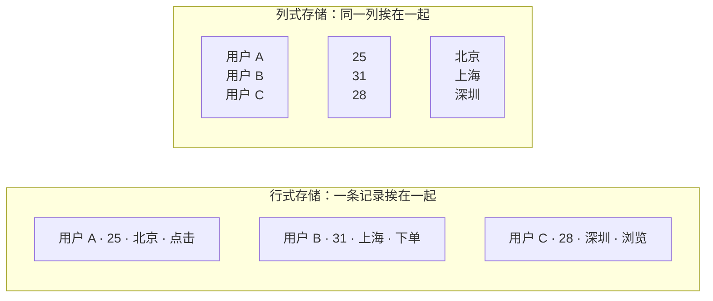
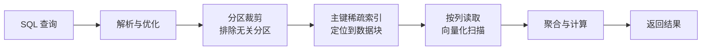
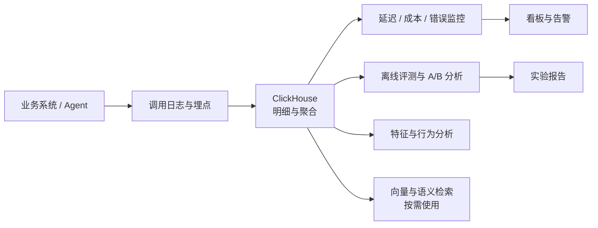

数据例会上，分析师说这张报表跑了一晚上还没出来，后端沉默了两秒，说：上 ClickHouse 吧。你心里冒出一串问号：ClickHouse 是什么房子？为什么换个仓库，报表就能从一晚上变成几秒钟？

名字确实带个 House，但它不是给人住的。ClickHouse 诞生在 Yandex，最早就是给点击流分析用的，Click 加 House，直译过来是「点击数据仓库」。你可以把它想成一个把所有货物竖着码放的超级仓库：同一个字段的值放在同一排货架上，查数的时候只去那几排，不用把每个箱子都翻一遍。

它到底是什么？一句话，ClickHouse 是一个开源的列式 OLAP 数据库，专门应付海量数据的扫描、聚合和分析。注意这里的两个关键词：列式 和 OLAP。理解了这两个词，它为什么快、什么时候不该用它，基本就清楚了。

## 同样是仓库，为什么它敢竖着放

传统数据库像 MySQL，习惯把一条记录的所有字段挨在一起放。查某个用户的资料很快，因为一次就能把整条记录拿到。但分析师常干的事不是查一个人，而是问「过去三个月，北京地区所有下单用户的平均客单价是多少」。这种查询要扫过海量记录，却只用到其中几个字段。行式存储会把每个用不上的字段也读一遍，读得越多，越慢。

列式存储换了个摆法：把同一列的值连续放在一起。

图里左边是行式，右边是列式。查「北京用户的平均年龄」时，列式只需要读年龄和城市两列，用户 ID 和动作类型可以完全不碰。读得少，自然快。

列式还有个隐藏福利：同一列的数据类型一致、取值相近，压缩起来特别划算。一百万条「北京、上海、深圳」重复出现，压缩后占的空间可能只有原来的零头。省下来的不只是磁盘，还有网络传输和内存占用。

这也解释了 OLTP 和 OLAP 的分工。OLTP 关心单条记录的增删改查和事务，比如下单、扣库存、改地址；OLAP 关心大批量数据的扫描和聚合，比如报表、漏斗、留存、归因。ClickHouse 是后者，它不是 MySQL 的替代品。

## 一条查询是怎么跑完的

把 SQL 丢给 ClickHouse 之后，它不会傻乎乎地从表头扫到表尾。整个过程更像仓库管理员按货架编号找货。

建表时通常会指定一个分区字段，比如按月分区。查询条件里带了时间范围，ClickHouse 就能先把不相关的月份整个跳过，这叫分区裁剪。数据量大、时间范围明确的分析查询，光这一步就能省掉大半扫描量。

分区内部还会按主键排序，并维护一份稀疏索引。它不需要给每一行都记一条索引，而是每隔一批数据记一个位置，默认每 8192 行算一个 Granule。索引很小，小到可以常驻内存。查询时先在内存里定位到可能命中的 Granule，再去磁盘读那几块，避免全表扫描。

真正读数据时，它按列批量处理，而不是一行一行地搬运。一批一批的列数据送进 CPU，配合 SIMD 指令并行计算，缓存命中率也高。这就是常说的向量化执行。单机跑满多核之后，还能把查询拆到多个分片上并行跑，结果再汇总回来。

## MergeTree：仓库的摆放规则

ClickHouse 最常用的表引擎叫 MergeTree。它的工作方式很朴素：每次批量写入，先按主键排好序，生成一个 Part；后台再不停地把小 Part 合并成大 Part。查询看到的是这些 Part 的集合，合并过程对查询透明。

这个设计带来一个很实际的要求：别一条一条地写。每次插入几十行、几百行，会迅速堆出大量小 Part，后台合并跟不上，轻则查询变慢，重则直接报「too many parts」。生产上通常攒批写入，几万行一批很常见；如果业务天然是高频小写入，可以用异步插入缓一缓，但那只是缓冲，不是鼓励你单条写。

建表时的两个选择，几乎决定了后面几年的查询体验。`ORDER BY` 是排序键，也是默认的主键，查询里最常用来过滤的字段应该放在前面，比如租户、时间、设备类型。`PARTITION BY` 决定分区粒度，按月通常够用；分区太细会让元数据和合并压力一起上来，分区太粗又失去了裁剪的意义。

MergeTree 还有几个变种，解决不同的问题。ReplacingMergeTree 可以按主键保留最新版本，适合做去重和准实时的 upsert，但去重发生在合并时，查询瞬间不保证已经完成。AggregatingMergeTree 用来存预聚合的中间状态，配合物化视图，把明细数据在写入时就压成小结果。SummingMergeTree 则适合累加型指标。

| 名词 | 你可以理解成 |
| --- | --- |
| MergeTree | ClickHouse 最常用的表引擎，负责按主键排序、分块存储和后台合并 |
| Part | 一次批量写入生成的数据块，后台会不断把小 Part 合成大 Part |
| Granule | 索引和扫描的最小单位，默认 8192 行 |
| 主键索引 | 稀疏索引，每个 Granule 记一条，体积小到可以常驻内存 |
| Partition | 按时间或业务字段切出的大分区，查询时可以先裁掉无关分区 |
| 分片与副本 | 分片把数据横向拆开，副本给同一份数据做冗余和高可用 |
| 物化视图 | 写入时顺带算好的预聚合结果，查询时直接读小结果 |

## 它凭什么快得这么离谱

ClickHouse 的快不是某一个黑科技，而是一串选择叠加出来的结果。

列式存储让它只读需要的列，压缩又让同样多的数据占用更少的 IO。数据按主键排好序，稀疏索引和分区裁剪把扫描范围一缩再缩。读进来的列数据连续摆放，CPU 缓存友好，配合向量化执行和 SIMD，一次能算一批值。单机多核跑满之后，分片再把压力摊到多台机器上。物化视图和预聚合把重复计算提前做掉，近似函数则允许你用一点点精度换数量级的速度，比如 `uniq` 估算去重人数、`quantile` 估算分位数。

这些手段凑在一起，才有了「十亿行数据秒级返回」的体验。但同样的引擎，换个查询形状、换个排序键，结果可能天差地别。ClickHouse 的快是有条件的快，不是装上去就自动生效。

## 它不擅长什么

ClickHouse 不是万能仓库，它的短板和长处一样明显。

它不擅长高频单条写入。每次插入都在生成 Part，单条写会把合并机制拖垮，事务型业务应该留在 MySQL 或其他 OLTP 数据库里。

它不擅长频繁更新和删除。`ALTER UPDATE`、`ALTER DELETE` 这类 mutation 是异步的重活，会重写数据块；轻量级删除改善了体验，但也不是给你做订单状态流转用的。需要频繁改单条记录，说明选错了库。

它不擅长高并发的小查询。一条查询会尽量吃满多核，几十条大查询同时上来，CPU 和内存很快就见底。它更适合少量的大分析查询，而不是成千上万的短查询。真要扛并发，通常靠加副本和排队，而不是指望单机。

它也不是全文搜索引擎。文本检索有跳过索引和一些新能力，但和 Elasticsearch 这类专门做搜索的系统不是一回事。大表 Join 同样吃内存，维度表可以走字典，事实表之间的大 Join 更常见的做法是提前宽表化或预聚合。

## 典型场景

只要业务问题是「从海量明细里快速算出统计结果」，ClickHouse 就很容易出现在架构图里。

用户行为分析是它的老本行，点击流、页面浏览、下单转化、漏斗和留存，都是典型的扫描加聚合。日志和可观测性也很常见，把应用日志、指标、链路数据集中起来，按服务和时间段查异常。广告投放需要实时看曝光、点击、消耗和 ROI，实时大屏要在几秒内刷新聚合结果，A/B 实验要对大样本做分组统计，IoT 和风控要处理大量设备事件，这些都在它的舒适区。

它不适合做交易库，也不适合做全文搜索。把它放在分析层，让它专心算数，通常比指望它什么都能干更靠谱。

## AI 项目里，ClickHouse 通常站在哪

AI 项目的数据有个共同点：事件多、字段杂、查询以统计为主。模型调用日志、用户反馈、实验分组、特征明细，天然适合往 ClickHouse 里放。

大模型应用的可观测性是个很典型的落点。每次调用记录模型名、输入输出 token 数、延迟、成本、错误码、会话 ID，按模型、功能、用户维度聚合，就能回答「哪个功能最烧钱」「哪次升级让延迟变高了」「错误集中在哪些请求上」。链路和会话明细数据量大，正好是列式数据库擅长的形状。

模型监控和实验分析也常放这里。预测结果的分布、特征的变化、用户反馈的正负样本、不同实验组的指标差异，都可以在同一套明细表上算。用户行为序列和特征分析同样顺手，按用户和时间排序之后，很多窗口函数和留存计算都能直接跑。

向量检索是另一个方向，但要谨慎看待。ClickHouse 能存 embedding，也能算距离，近年的版本在加向量索引能力；可如果你的核心需求是高并发、低延迟的语义检索，专用向量数据库通常更成熟。更稳的分工是让 ClickHouse 负责「围绕向量的统计分析」，比如召回率、命中分布、不同模型的向量对比，把在线检索交给更合适的组件。

## 评审会上可以问这几句

**数据规模**：现在有多少亿行，每天新增多少，保留多久？按这个增速，半年后磁盘和查询还撑得住吗？

**写入模式**：数据是批量导入还是单条写入，峰值每秒多少条？能不能攒批，能不能接受分钟级延迟？

**查询模式**：主要是点查还是扫描聚合，P95 延迟目标是多少，同时会有多少条查询？如果都是高并发小查询，ClickHouse 可能不是最优解。

**更新删除**：业务需要频繁改单条记录吗？能接受异步 mutation 和最终一致吗？如果答案是不能，得重新考虑存储选型。

**数据模型**：`ORDER BY` 和 `PARTITION BY` 怎么定，基数多高，会不会出现分区爆炸或热分区？排序键和常见查询条件对得上吗？

**集群与成本**：几个分片、几个副本，Keeper 怎么部署，故障切换的 RTO 和 RPO 是多少？自建还是云托管，压缩后的磁盘成本和扩容周期大概什么量级？

## 收个尾

ClickHouse 不是一栋房子，而是一个把数据竖着码放的仓库。它把「只读需要的列」这件事做到了极致，再用压缩、排序、稀疏索引、向量化执行和分布式并行，把海量数据的分析查询压进秒级。它的边界也同样清楚：不做高频单条写入，不做频繁更新，不做高并发小查询，也不替你做全文搜索。

下次再听到「上 ClickHouse 吧」，你可以先问一句：我们的数据是拿来反复扫描聚合的，还是拿来一条条改的？答案不同，仓库的选法就不同。

> 一句话带走：ClickHouse 是为海量扫描和聚合而生的列式 OLAP 数据库，快在「只读该读的列」，但别拿它当交易库、搜索库或高频更新库。
{: .prompt-tip }
