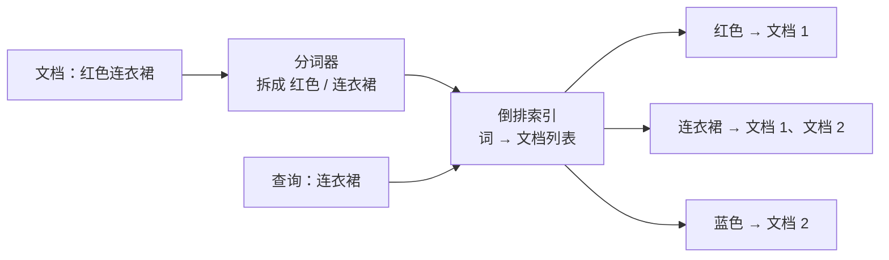

产品经理在搜索框里敲下「红色连衣裙」，不到半秒，结果就出来了。你问后端这是什么魔法，他说：Elasticsearch。你可能会愣一下：弹力搜索？这名字听着像某种健身器材。

Elastic 是弹性的意思，Search 是搜索，合起来可以理解成「有弹性的搜索」。弹性说的是它能横向扩展、扛得住数据和流量的增长，不是让你在搜索框里做拉伸运动。它到底是什么？一句话，Elasticsearch 是一个基于 Apache Lucene 的分布式搜索和分析引擎，用 JSON 文档存数据，用 REST 接口读写，最擅长的事情是从大量文本里快速找到相关的内容。

你可以把它想成一本倒着写的字典。普通字典是「词 → 解释」，它是「词 → 这个词出现在哪些文档里」。查「连衣裙」，它不用翻遍所有商品描述，而是直接翻到「连衣裙」那一页，拿到一串文档编号，再按相关度排个序。理解了这本倒着写的字典，它为什么快、为什么有时候搜得不准，基本就有谱了。

## 搜索框背后，为什么不能直接用 LIKE

很多项目一开始都是在 MySQL 里用 `LIKE '%关键词%'` 做搜索。数据量小的时候能用，数据一多就开始露馅。

前置通配符让普通索引失效，数据库只能一行行扫过去；商品描述、文章正文这种大字段，扫起来尤其疼。更麻烦的是，`LIKE` 只会告诉你「包含不包含」，不会告诉你「哪条更相关」。用户搜「红色连衣裙」，一条标题里正好有这五个字，另一条描述里提到十次红色和连衣裙，哪条应该排前面？`LIKE` 没有答案。

它也不处理分词、同义词、拼写错误和中文语境。「连衣裙」和「裙子」是不是一个意思，「T 恤」和「t恤」要不要当成同一个词，用户把「连衣裙」打成「连衣群」还要不要给结果，这些事情靠 `LIKE` 很难做。

Elasticsearch 从设计上就是冲着这些问题来的。它先把文本拆成词，建好倒排索引，再用相关度算法打分排序。它不是 MySQL 的替代品，而是搜索和分析这件事上的专用工具。

## 它其实是一本倒着写的字典

倒排索引的核心，是把「文档包含哪些词」翻过来，变成「词出现在哪些文档里」。

一份文档进来，先过分词器。分词器把句子拆成一个个词，顺手做小写转换、去停用词、词干还原，必要时还会加同义词。比如「红色连衣裙」会被拆成「红色」和「连衣裙」两个词。然后每个词去查自己的 posting list，把当前文档的编号挂上去。

图里的 posting list 就是那本倒着写的字典的正文。词是字典的索引项，文档编号是解释。真实实现里还会记录词在文档中出现的位置和次数，用来支持短语查询和相关度打分。

查询的时候，Elasticsearch 对查询词做同样的分词，然后去倒排索引里找 posting list，把候选文档捞出来。因为词表是有序的，查找可以做到很快；因为只碰包含查询词的文档，不用全量扫描。

中文分词是个容易踩坑的地方。默认分词器对中文不算友好，实际项目里通常要装 IK 之类的分词插件，或者用 smartcn、jieba 这类方案。分词分得好不好，直接决定搜索能不能用。把「红色连衣裙」切成「红」「色」「连」「衣」「裙」，搜索体验基本就废了。

## 写入和查询：一条数据怎么进来，又怎么被找到

Elasticsearch 的写入不是「存进去立刻就能查到」。它走的是一条带缓冲和日志的路径。

写请求先到协调节点，按文档 ID 算出应该落在哪个主分片，转发过去。主分片对字段做分析、写入内存缓冲区，同时把操作记进 translog。默认每隔一秒，缓冲区里的数据会被 refresh 成一个新的 segment，这时候文档才能被搜索到。segment 再在后台合并，flush 时把数据真正落盘。translog 负责在节点挂掉时把没落盘的操作找回来。

这也解释了为什么它叫近实时搜索。默认有一秒左右的延迟，不是写完马上就能查到。需要「写后立即可查」的场景，可以强制 refresh，但频繁 refresh 会产生大量小 segment，查询性能会受影响。对搜索来说，一秒的延迟通常可以接受；对账、库存这类要求强一致的业务，就不该指望它。

查询走的是另一条路。请求先分发到目标索引的各个分片，每个分片在自己的倒排索引里找候选文档，用 BM25 算出相关度分数，返回 Top N 的文档 ID 和分数。协调节点把各分片的结果合并、重新排序，再去取回文档内容，返回给用户。

分片在这里承担了并行和扩展的角色。索引大到一个节点放不下，就切成多个主分片分散到不同节点；每个主分片再配副本，副本既能分担读请求，也能在主分片挂掉时顶上。

## 它为什么搜得准，而不只是搜得快

倒排索引解决的是「找得到」，相关度算法解决的是「排得对」。

Elasticsearch 默认用 BM25 打分。它看三件事：查询词在文档里出现了几次，这个词在整个索引里有多稀有，以及文档字段有多长。一个词出现得越多，分数越高；但在所有文档里都很常见的词，权重会被压低；字段越长，单个词的分量越容易被稀释。这套逻辑比简单的「包含关键词就加一分」细腻得多。

工程上还能做很多事。给标题字段更高的权重，给类目和品牌加过滤条件，用同义词把「连衣裙」和「裙子」连起来，用短语查询要求两个词挨得足够近，用 function_score 把销量、评分、上架时间这些业务因素揉进排序。搜索的「准」很少是开箱即用的，更多是一轮轮调出来的。

这里有个容易被忽略的事实：相关度不是纯技术问题。产品经理觉得「搜得不对」，可能不是算法坏了，而是分词不对、字段权重不对，或者根本没有一套可量化的评估标准。上线前准备一批查询和人工标注的期望结果，算一算召回率和前几条的命中情况，比拍脑袋调参数靠谱得多。

## 拆开看：索引、分片、副本

Elasticsearch 的几个核心名词，用一张表就能对上号。

| 名词 | 你可以理解成 |
| --- | --- |
| Index | 一类文档的集合，类似数据库里的表 |
| Document | 一条 JSON 记录，类似一行数据 |
| Mapping | 字段类型和索引规则，类似表结构 |
| Analyzer | 分词器，把句子拆成可检索的词 |
| Inverted Index | 倒排索引，记录每个词出现在哪些文档里 |
| Shard | 索引的水平分片，负责扩展和并行 |
| Replica | 分片的副本，负责高可用和读分担 |

Index 这个名字容易让人误解成数据库索引，其实它更像一张表。Mapping 则决定了每个字段怎么被索引：是当成可分词的全文，还是当成精确匹配的关键词；是数值、日期，还是地理位置。字段类型定错了，后面查询和聚合都会别扭。

分片是容量和性能的基本单位。主分片数在创建索引时就要规划好，后续虽然能 split 或 shrink，但成本不低。分片太少，单分片太大，恢复和迁移都慢；分片太多，集群状态和文件句柄的开销又会上来。单个分片通常控制在几十 GB 以内，具体要看数据量、写入和查询模式。

副本数可以随时调整。副本越多，读能力和容灾能力越强，但写入要同步到更多节点，磁盘成本也更高。生产环境一般至少一主一从，关键业务再往上加。

## 它不擅长什么

Elasticsearch 很好用，但它不是万能数据库，边界得提前说清楚。

它不适合当主存储。没有跨文档事务，没有关系库那种 Join，近实时刷新也意味着写完之后不一定马上能读到。订单、库存、账务这类要求强一致的系统，应该把 MySQL 或别的 OLTP 数据库放在前面，Elasticsearch 作为搜索副本存在。

它不擅长深分页。`from + size` 翻到一万条以后，默认就会被拦住；翻得越深，每个分片要取的候选文档越多，开销越大。真要做深度遍历，得用 `search_after` 或者快照分页。

它怕 mapping 爆炸。动态映射很省事，但字段一多，集群状态会膨胀，写入和查询都会变慢。字段数量是有上限的，生产环境通常要显式定义 mapping，把不需要搜索的字段关掉索引。

它也挺吃资源。JVM 堆、文件系统缓存、磁盘 IO 都要给足，节点不是随便找台机器就能跑。分片规划不好、refresh 太频繁、聚合基数太大，都会让集群从「秒回」变成「转圈」。

还有许可和托管的选择。Elasticsearch 的授权经历过变化，不同版本的许可不完全一样，常见的有 Elastic License、SSPL 和 AGPL 等选项；OpenSearch 是另一条分支。选型时确认版本、许可和托管方式，别等上线后才发现用不了。

## 典型场景

只要业务问题是「从大量内容里快速找到相关的几条」，Elasticsearch 就很容易出现。

站内搜索和商品搜索是最典型的。标题、描述、标签、品牌、类目一起建索引，支持关键词、过滤、排序和分面聚合，用户在左侧勾选「颜色」「尺码」，右侧结果实时收敛，这套体验背后通常就是它。

自动补全和搜索建议也常找它。用户刚输入两个字符，就要给出候选词，completion suggester 和 edge n-gram 都是常见做法。

日志和可观测性是另一大主场。Elasticsearch、Logstash、Kibana 组成的 ELK 栈，加上 Beats 采集，几乎成了日志分析的标准套餐。按服务、时间、错误码查日志，做聚合看板，配索引生命周期管理把冷数据往下沉，都是成熟玩法。安全分析和地理搜索也用得上它。

知识库、文档检索、站内帮助中心，这些场景的本质都是全文检索加相关性排序，正好在它的舒适区。

## AI 项目里，Elasticsearch 通常站在哪

到了 RAG 和 AI 应用里，Elasticsearch 最常见的身份是「检索层」。

一份文档进来，先切块，再分别走向量化和全文索引。用户提问时，一边用 BM25 做关键词召回，一边用向量做语义召回，两路结果融合排序，再把最相关的片段交给大模型生成答案。这就是常说的混合检索。

纯向量检索擅长语义相近，但对专有名词、型号、错误码这类精确词不敏感；纯关键词检索反过来。混合检索把两边的好处拼在一起，再用 reciprocal rank fusion 之类的办法融合排名，通常在真实业务里更稳。Elasticsearch 近年的版本对 dense vector、kNN、稀疏向量和混合检索的支持越来越完整，做 RAG 的检索层是够用的。

它也很适合放 LLM 应用的观测数据。每次调用的输入输出、token 数、延迟、成本、错误码、会话 ID，写进索引之后，用 Kibana 做看板，按模型、功能、用户维度聚合，能很快回答「哪个功能最烧钱」「哪次升级把延迟拉高了」。日志和链路数据本来就是它的强项。

不过别把它当成默认的向量数据库。纯高并发、低延迟的向量检索，专用向量库可能更合适；Elasticsearch 的优势在于全文加向量加过滤条件放在一起，而且团队已经在用 Elastic Stack。选型看的是组合需求，不是单项跑分。

## 评审会上可以问这几句

**数据规模**：文档数、每日增量、单条大小、保留多久？按这个增速，分片和磁盘半年后还够不够？

**写入与实时性**：写入峰值多少，能接受默认一秒左右的 refresh 延迟吗？有没有「写完立刻要查到」的场景？

**查询与相关性**：主要查询类型是什么，P95 延迟目标多少，Top N 要取多少？相关性有没有评估集，谁来负责调？

**Mapping 与分词**：字段谁维护，会不会开自动映射？中文分词、同义词、拼写纠错怎么配？字段数量会不会失控？

**分片与副本**：主分片数怎么定，单分片多大，副本几个？集群节点怎么分工，故障切换的 RTO 和 RPO 是多少？

**深分页与聚合**：业务需要翻多少页，聚合基数多大？如果要做全量导出，准备用 search_after 还是别的通道？

**成本与许可**：自建还是托管，内存、磁盘、节点数大概什么量级？用的哪个许可版本，后面会不会受限制？

**边界**：它是主存储还是搜索副本？能不能接受最终一致？需不需要事务和 Join？这些问题的答案，决定它该不该进这个架构。

## 收个尾

Elasticsearch 不是一个更大的数据库，而是一本倒着写的字典，外加一个会打分的图书管理员。它把「找得到」变成「找得准」，靠的是分词、倒排索引、BM25 和分片并行。它的边界也同样清楚：不做主存储，不做跨文档事务，不擅长深分页，mapping 和分片要提前规划。

下次再听到「上 Elasticsearch 吧」，你可以先问一句：我们要的是搜索，还是存储？如果是搜索，再问一句：相关性准备怎么评估？这两个问题问清楚，后面的坑会少很多。

> 一句话带走：Elasticsearch 是为全文检索和搜索分析而生的倒排索引引擎，强在分词、相关度和横向扩展，但别把它当主数据库、事务库或万能存储。
{: .prompt-tip }
