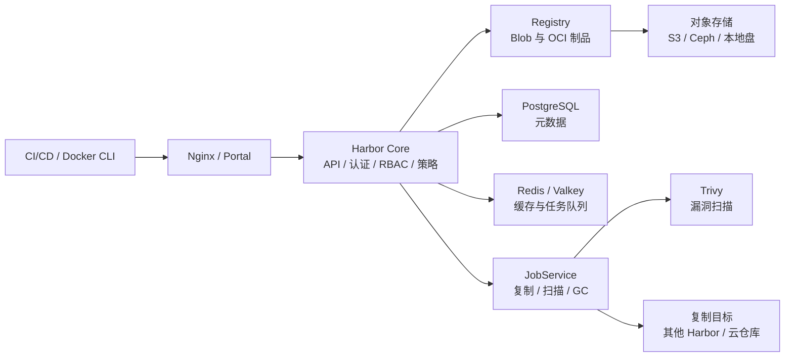
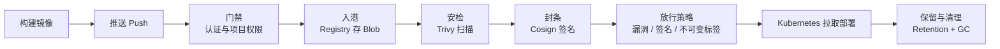
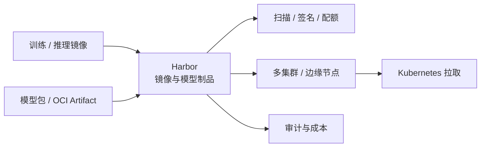

凌晨发布，流水线里镜像推上去了，Kubernetes 却拉不下来。安全同学又在群里问：这个镜像谁扫过，为什么生产还在用三个月前的 tag？后端说：上 Harbor 吧。你心想，Harbor 不是港口吗，怎么管起镜像来了？

Harbor 确实是一座港口，只不过停靠的不是货轮，而是容器镜像和 OCI 制品。它是开源的云原生仓库，2016 年从 VMware 中国研发团队开源，2018 年进入 CNCF，2020 年毕业。项目是码头分区，仓库是货架，镜像是集装箱，RBAC 是门禁，Trivy 是海关安检，Cosign 是封条，复制策略是航线，保留策略和 GC 是堆场清理。理解了这座港口，镜像从构建到上生产的那条链路，基本就清楚了。

## 镜像不是扔进仓库就完了

很多人对镜像仓库的印象，还停留在「找个地方存镜像」。用 Docker Hub 公共仓库，或者随便起一个基础 Registry，确实能存。但一旦进了生产，问题就来了。

公共仓库有拉取限流，网络不稳定的时候流水线直接卡住；基础 Registry 没有项目隔离、没有细粒度权限、没有漏洞扫描、没有签名校验，谁都能推，谁都能拉。镜像里用了哪个基础镜像、有没有高危漏洞、这个 tag 是不是被人覆盖过，全靠人记。供应链安全出事的时候，连追溯都做不到。

Harbor 解决的不是「存不下」，而是「管不住」。它把仓库做成了一个有门禁、有安检、有航线、有库存管理的港口。镜像进来要过权限，出去要过策略，跨地域要按航线调货，过期了要按规则清运。它不是一个更大的 Docker Registry，而是一层围绕制品的治理系统。

## 先认识港口的几个区域

Harbor 的名词不多，但每个都对应一个实际的管理边界。

| 名词 | 你可以理解成 |
| --- | --- |
| Project | 码头分区，团队、权限和配额的边界 |
| Repository | 一条航线的货架，同一镜像的不同版本放在这里 |
| Artifact | 一个具体的集装箱，可能是镜像、Helm Chart、SBOM 或模型包 |
| Tag / Digest | 标签是外号，Digest 是身份证；生产更应该认 Digest |
| Robot Account | 给 CI/CD 用的专用门禁卡，不绑定真人账号 |
| Replication | 港口之间的调货航线，按策略异步同步 |
| Retention / GC | 堆场清理规则，以及真正把无用数据清走的动作 |

Project 是最容易被低估的一层。它不只是个目录，而是权限、配额、扫描策略、保留策略和复制策略的作用域。把项目边界划清楚，后面很多治理问题会简单很多。

Tag 和 Digest 的区别也值得项目经理记住。Tag 像「latest」「v1.2」这种外号，可以被移动、被覆盖；Digest 是根据内容算出来的身份证，内容变一点，Digest 就变。生产环境认 Digest，或者开启不可变 Tag，能避免「同一个版本号，今天和昨天跑出不同结果」这种事。

## 港口里面有什么

Harbor 不是一个单体进程，而是一组分工明确的服务。可以把它想成港口的各个部门。

Core 是港口的大脑，负责 API、认证、权限、项目、配额、复制策略、保留策略、扫描策略和 Webhook。Registry 是堆场，真正存 Blob 和 OCI 制品，它本身不负责复杂的权限判断，而是信任 Core 发来的令牌。JobService 是码头工人，复制、扫描、垃圾回收这些耗时任务都交给它异步执行。Trivy 是海关安检，负责查镜像里的漏洞。PostgreSQL 存元数据，Redis 或 Valkey 负责缓存和任务队列，对象存储放真正的数据。

这套拆分带来一个实际好处：扫描慢了不会把 API 拖死，复制堵了也不会影响推拉镜像。代价是运维复杂度上来了。生产环境要做高可用，通常得把 PostgreSQL、Redis 或 Valkey、对象存储放到外面，多个 Core、Registry、JobService 实例挂在负载均衡后面，共享同一套存储。单机 all-in-one 适合试用，不适合承担生产。

## 一个镜像的港口旅程

把镜像推上去，只是旅程的开始。

推送时，Harbor 先看你是谁、有没有这个项目的写权限，然后由 Registry 把镜像层存进对象存储。镜像落地之后，可以触发漏洞扫描，也可以触发签名。项目可以配置策略：超过某个严重级别的漏洞不允许拉取，没有签名的镜像不允许进生产，Tag 一旦推送就不能覆盖。

拉取时，Kubernetes 拿到的是一张短期令牌，Registry 校验之后才放行。扫描和签名本身不会让镜像变安全，它们只是把「这个镜像是什么、从哪来、有没有已知漏洞、是谁签的」变成可查的事实。真正要挡住风险，还得在部署入口做准入校验，比如用 Kyverno 或 OPA 检查签名和 Digest。

Retention 和 GC 是旅程的终点站。Retention 决定哪些 Tag 该留、哪些该删，GC 负责把没有被引用的 Blob 真正清走。GC 是重活，跑起来会吃 IO，生产上通常要安排窗口，别和发布高峰撞在一起。

## 它到底解决了什么问题

Harbor 的价值，集中在「治理」两个字上。

**多租户和权限**。Project 把团队、镜像、配额和策略隔开，RBAC 控制谁能读、谁能写、谁能扫、谁能复制。Robot Account 给 CI/CD 用，权限可以只开到某个项目、某个仓库，不用把真人账号和密码塞进流水线。OIDC 和 LDAP 接进来之后，人员离职、转岗，权限也跟着企业账号体系走。

**供应链安全**。Trivy 可以在推送时自动扫描，也可以按需扫描；项目可以设置漏洞严重级别的门槛。Cosign 或 Notary 用来签名，配合不可变 Tag 和 Digest，能回答「这个镜像是不是我们构建的、有没有被替换过」。SBOM 则把镜像里的软件清单留下来，出事时能查依赖。近年的版本还把 SBOM 生成、AI 模型制品管理这些能力往前推了一步。

**多地域复制**。Replication 可以按项目、仓库、Tag 过滤，把镜像从一个 Harbor 同步到另一个 Harbor，或者同步到云厂商的镜像仓库。多集群、混合云、边缘节点、离线机房，都靠这条航线。它是异步的，适合做分发，不适合当双活存储，也不等于备份。

**代理缓存**。Proxy Cache 项目可以代理 Docker Hub、GHCR 这类上游仓库，头一次拉取时缓存到本地，后面直接命中。对经常被上游限流、或者出口带宽有限的团队，这个功能很实用。但它是缓存，不是事实来源，上游挂了、缓存没命中，还是得回到上游。

**生命周期管理**。项目配额限制存储增长，Retention 规则控制 Tag 保留，GC 清理无引用数据，审计日志记录谁在什么时候推了、拉了、删了什么，Webhook 可以把这些事件接到告警和流水线里。对受监管行业，这些记录本身就是合规材料。

## 港口也有管不到的地方

Harbor 很好用，但它不是万能工具箱，边界要提前说清楚。

它不负责构建镜像，也不负责跑 CI/CD。镜像怎么构建、用什么基础镜像、什么时候推，是流水线的事；Harbor 管的是推上来之后怎么存、怎么审、怎么发。它也不负责运行容器，Kubernetes 该拉镜像还是拉镜像，Harbor 只是那个被拉的地方。

它不是通用的制品仓库。OCI 制品它能管，Helm Chart、SBOM、OPA 策略、模型包都能塞进去，但 Maven、npm、PyPI 这类生态，Nexus 或 Artifactory 更合适。选型时别指望一个 Harbor 把所有包都收了。

它也不是完整的漏洞管理平台。扫描结果依赖扫描器和漏洞库的更新，误报、漏报、基础镜像的历史漏洞都存在。Harbor 能告诉你「有这个 CVE」，但不能替你决定「这个 CVE 在我们的业务里能不能接受」。CVE 白名单、修复优先级、例外审批，仍然要有人负责。

高可用和运维是另一道坎。Harbor 是有状态系统，数据库、缓存、对象存储、共享存储都要规划；升级、备份、恢复、GC、容量扩展，都需要运维投入。复制不是备份，代理缓存不是事实来源，签名也不等于安全。把这些边界想清楚，比堆功能更重要。

## 典型场景

只要团队开始认真管镜像，Harbor 就很容易出现。

私有镜像仓库是最基础的用法。Kubernetes 集群从 Harbor 拉镜像，项目按团队划分，CI 用 Robot Account 推送，生产只允许拉取经过扫描和签名的 Digest。多集群和多云环境，用复制策略把镜像分发到各区域，减少跨地域拉取的延迟和出口成本。混合云和离线机房，用离线复制或导出包把镜像带进去。受监管行业则更看重审计日志、不可变 Tag、签名和保留策略，这些在 Harbor 里都有对应的抓手。

AI 平台也在用它。训练镜像、推理镜像、推理服务的 Sidecar、模型包，都可以作为 OCI 制品放在 Harbor 里，再通过复制分发到多个集群或边缘节点。

## AI 项目里，Harbor 通常站在哪

AI 项目的基础设施，本质上还是容器和制品。Harbor 站的位置，通常在「制品从哪来、能不能信、怎么送到各个集群」这一段。

训练平台构建出来的镜像，推送到 Harbor，扫描、签名之后再分发给训练集群和推理集群。模型如果打成 OCI 制品，也可以走同一条链路，尤其是需要在多个边缘节点分发同一版本模型的场景。近年的 Harbor 版本在往 AI 模型制品方向扩展，模型包、模型卡这类东西可以纳入同一套权限、复制和审计体系。

但别把它当成模型管理平台的全部。模型血缘、训练数据版本、评测指标、实验追踪，这些不是 Harbor 的核心能力，专门的模型注册表或实验平台更合适。Harbor 能管的是「模型包作为一个制品，怎么安全地存和送」，不是「这个模型为什么比上一个好」。

## 评审会上可以问这几句

**制品规模**：现在有多少镜像和 Tag，每天新增多少，单个镜像多大？存储后端用对象存储还是本地盘，配额和扩容怎么定？

**高可用与恢复**：PostgreSQL、缓存、对象存储是否外置，Core、Registry、JobService 各有几个副本？备份频率、恢复演练、RTO 和 RPO 是多少？

**安全策略**：推送时自动扫描还是按需扫描，严重级别门槛怎么定？签名用 Cosign 还是 Notary，部署入口有没有准入校验？不可变 Tag 开不开？

**复制拓扑**：有几个 Harbor 实例，复制方向是什么，带宽和延迟能不能接受？离线机房怎么同步，复制失败怎么补偿？

**权限与审计**：OIDC 或 LDAP 接不接，Project 怎么划分，Robot Account 的权限开到多细？审计日志保留多久，Webhook 接到哪里？

**生命周期**：Retention 规则怎么定，GC 多久跑一次，跑的时候要不要停写？配额告警、存储成本、版本升级路径谁负责？

**边界**：我们需要的是镜像仓库、通用制品仓库，还是模型注册表？Harbor 和云厂商托管仓库、Nexus、Artifactory 之间怎么分工？

## 港口真正管的，不是货，是信任

Harbor 不是避风港。避风港只负责让船停下来，港口要管的是货从哪来、能不能进、谁放行、出了事能不能追。镜像也一样。它不会让一个烂镜像变安全，但它能让每一次推送、扫描、签名、复制和删除都留下记录，让「这个镜像能不能上生产」从一句口头保证，变成一条可查的链路。

下次再听到「上 Harbor 吧」，你可以先问一句：我们要的是一个存镜像的地方，还是一座有门禁、有安检、有航线的港口？

> 一句话带走：Harbor 是给容器镜像和 OCI 制品做安检、发通行证、管库存、开航线的云原生港口，不是构建工具，也不是运行时。
{: .prompt-tip }
