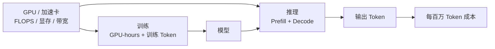
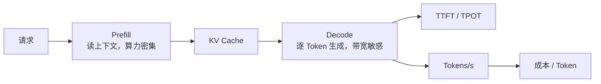
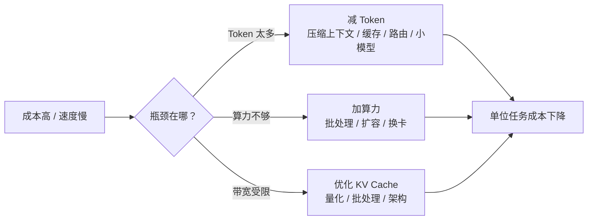

预算会上，平台团队说 GPU 不够，业务团队说 Token 太贵。两边都在要钱，但说的不是同一件事。一个在说产能，一个在说产量；一个按机器小时算，一个按词元算。把这两个词混在一起，预算会很容易变成鸡同鸭讲。

先把一句话放在前面：算力是产能，Token 是产量和计量单位。算力回答「能跑多快、能同时跑多少」，Token 回答「处理了多少内容、按什么单位计费」。两者强相关，但不能直接换算。

把它想成一家印刷厂。算力是印刷机、工时和纸张，Token 是印出来的字。客户按字报价，工厂按机器工时和材料算成本。同样的字，换一台机器、换一种排版、换一种纸张，成本完全不同。所以「一个字多少钱」和「一小时机器多少钱」是两套账，不能直接画等号。

## 算力的单位，到底在量什么

算力不是一个单一数字。买卡时看 FLOPS，跑模型时看显存和带宽，算成本时看 GPU-hours，评估效率时看 MFU。它们量的是不同的东西，混着用就会得出奇怪的结论。

**FLOPS 是理论峰值，必须带精度。** FLOPS 指每秒浮点运算次数，TFLOPS 和 PFLOPS 是它的量级。同样一张卡，跑 FP32、FP16、BF16、FP8、INT8，吞吐可能差出几倍。精度越低通常越快，但模型效果、数值稳定性和适用场景要另算。只看一个「多少 TFLOPS」的数字，不看精度，基本没有可比性。

**GPU-hours 是实际用量，不是有效产出。** 一张卡跑一小时就是 1 GPU-hour，一个八卡节点跑十小时就是 80 GPU-hours。它是算力成本和容量的常用口径，但卡在等数据、等网络、等调度的时间也会被算进去。买了多少卡、跑了多少小时，和真正产出了多少 Token，中间还隔着利用率。

**VRAM 决定能装下什么。** 显存容量决定模型权重、KV Cache 和 batch 能放多少。显存不够，再高的 FLOPS 也跑不起来；显存够但带宽不够，解码速度照样上不去。

**显存带宽决定解码快不快。** 单位是 GB/s。大模型逐 Token 生成时，经常卡在显存带宽上，而不是卡在 FLOPS 上。这也是为什么两张峰值算力接近的卡，跑同一个模型的 Token 速度可能差很多。

**MFU 和利用率衡量「用上了多少」。** MFU 是实际算力利用和理论峰值的比例，利用率是更宽泛的资源占用比例。利用率高不一定是好事，可能是在空转、排队或者做无效计算；真正要看的还是有效吞吐和每任务成本。

**tokens/s、TTFT、TPOT 是推理产出指标。** tokens/s 是吞吐，TTFT 是首 Token 延迟，TPOT 是每个输出 Token 的延迟。成本口径则常用每 GPU 小时多少钱，或者每百万 Token 多少钱。

记住三句话：卡数不是算力，峰值不是有效算力，训练和推理也不能用同一把尺子。

## Token 的单位，到底在量什么

Token 是分词器切出来的文本单位，不是字，也不是词。模型先按自己的词表把输入切成 Token，再一个接一个地生成输出 Token。不同模型的分词器不一样，同一段话切出来的 Token 数就可能不一样。

英文里，`unbelievable` 可能被拆成 `un` + `believ` + `able`，`tokenization` 可能被拆成 `token` + `ization`。中文里，「人工智能」在有的分词器里是一个 Token，在另一些里可能是「人工」+「智能」两个，甚至四个字各一个。同一段 100 字的中文，在不同模型里 Token 数可能差出几十个；中文和英文的 Token 密度也不一样。所以不要用「字数 × 固定系数」做预算，那个系数根本不固定。

Token 还分输入和输出。输入 Token 是提示词、上下文、检索片段，输出 Token 是模型生成的答案。API 通常把两者分开计价，输出往往更贵。上下文窗口则是模型一次能看的 Token 上限，不是免费容量；窗口越大，KV Cache 和预填充的开销越大。

更重要的一点：Token 是一种计量单位，不是物理资源。它没有统一的内在价值，不同模型、不同供应商的 Token 不能直接比价。拿两个模型的 Token 单价对比之前，先确认它们的分词器、输入输出比例、上下文长度和任务效果是不是可比。

## 两者怎么关联

训练和推理是两条链路，算力和 Token 在其中的角色不一样。

训练时，算力用量是 GPU-hours，Token 是训练数据量。更多算力、更多数据通常能提升能力，但不是线性关系；数据质量、数据配方、模型结构和训练策略同样重要。把「堆了多少卡」直接等同于「模型一定更强」，是另一种常见的误读。

推理时，算力被用来处理输入和生成输出。预填充（Prefill）阶段把上下文读一遍，算力密集；解码（Decode）阶段一个 Token 一个 Token 地生成，往往受显存带宽和 KV Cache 限制。批处理能提高吞吐，但会增加延迟；上下文越长，KV Cache 越大。这也是为什么「加卡」不一定能让每个请求变快，有时只是让更多请求一起排队。

把成本摊到 Token 上，可以用一个简化公式：

**每百万 Token 成本 ≈ 每小时算力成本 ÷ 每小时产出 Token 数 × 1,000,000**

假设一台推理实例每小时 2 美元，稳定产出 1,000 个输出 Token/s，一小时就是 360 万 Token，每百万 Token 约 0.56 美元；如果能做到 2,000 Token/s，就降到约 0.28 美元。再加上存储、网络、运维、闲置和冗余，实际成本会更高。这组数字只用来建立数量级直觉，不是厂商报价；真实产出取决于模型大小、上下文、批处理、精度、硬件和利用率。这个公式按输出 Token 粗算，预填充、输入处理和批处理开销都会让实际成本更高；输入和输出分开计价的 API，还要分别算。

API 的 Token 单价是打包价，里面包含服务商的算力成本、批处理效率、闲置、利润和风险。不能拿单价反推一张卡的成本，也不能拿一张卡的理论峰值去推 API 的 Token 价格。

## 一张表看清

| 维度 | 算力 | Token |
| --- | --- | --- |
| 本质 | 硬件和时间的产能 | 模型处理内容的计量单位 |
| 单位 | FLOPS、GPU-hours、VRAM、GB/s | 输入/输出 Token、1K/1M Token |
| 计价 | GPU 小时、包年包月、电费运维 | API 按 Token 单价；自建折算 |
| 瓶颈 | FLOPS、显存、带宽、互联、利用率 | 模型大小、上下文、批处理、解码带宽 |
| 扩展 | 加卡、加节点、换卡 | 减 Token、缓存、路由、小模型 |
| 指标 | MFU、利用率、GPU-hours、成本/GPU 小时 | TTFT、TPOT、tokens/s、成本/百万 Token |
| 关系 | 产能 | 产量/计量单位 |

## 几个最容易踩的误区

**Token 等于字数。** 分词器不同，Token 数就不同；中文、英文、代码、标点的 Token 密度都不一样。用字数估预算，误差可能大到没法用。

**一张卡一天能跑多少 Token 有固定答案。** 没有。模型大小、上下文、批处理、精度、硬件、利用率一变，答案就变。正确的问法是：在某个模型、某个上下文长度、某个延迟目标下，这张卡能跑多少 Token/s。

**Token 单价低就是总成本低。** 还要看输入输出比例、缓存命中、重试、上下文膨胀和 Agent 循环。一个单价便宜但每任务多跑三轮的模型，总成本可能更高。

**上下文窗口大就是免费。** 窗口越大，KV Cache 越大，预填充越重，长上下文还会拖慢解码。窗口是能力，不是成本豁免。

**算力堆得多，Token 就一定便宜。** 如果瓶颈在显存带宽、调度或批处理，加卡未必能提高有效吞吐；利用率上不去，单位 Token 成本反而更高。

**GPU 利用率高就是产出高。** 利用率可能被空转、排队和无效计算撑高。要看有效吞吐、每任务成本和实际交付的 Token。

**训练和推理用同一套指标。** 训练更看吞吐和 GPU-hours，推理更看 TTFT、TPOT、并发和每 Token 成本；预填充和解码的瓶颈也不一样。

**Token 是一种资源。** 它是计费单位，不是石油或电力。价格是商业定价，不是物理成本。

## 项目里怎么用

**预算拆开。** 算力预算按 GPU 小时、云账单或集群折旧算，Token 预算按 API 账单或推理调用量算。两边分开看，再合到「每任务成本」这个统一口径上。

**容量规划先压测。** 先估 Token 需求：输入、输出、平均上下文、峰值并发、重试和 Agent 循环。再用接近真实的 workload 压测，得到 tokens/s、TTFT、TPOT，再换算成 GPU 容量。不要用理论峰值直接乘。

**供应商比价看每任务成本。** 不要只比 Token 单价，把输入输出比例、缓存、重试、限流、延迟和可用性都算进去。两个模型完成同一个任务，消耗的 Token 和调用次数可能完全不同。

**优化先找瓶颈。** Token 太多，就压缩提示、裁剪 RAG 上下文、做缓存、做模型路由、换小模型、蒸馏或量化；算力不够，就做批处理、扩容、换卡、优化互联。两个杠杆不要混着用，否则很容易花了钱却没解决问题。

**训练看 GPU-hours，也看数据。** 训练 Token 的数量和质量，决定了算力花得值不值。更多算力不等于更好模型，数据配方和评测同样关键。

## 评审会上可以问这几句

**口径**：我们现在说的是 GPU-hours、FLOPS，还是 Token 单价？先把单位对齐，再谈钱。

**需求**：输入和输出的 Token 比例是多少，平均上下文多长，峰值并发多少？重试和 Agent 循环有没有算进去？

**容量**：在目标模型和上下文下，一张卡或一个实例能稳定产出多少 Token/s？TTFT 和 TPOT 的目标是多少？

**成本**：每任务成本、每百万 Token 成本、GPU 利用率和闲置率分别是什么？算力账单和 Token 账单能不能对上？

**瓶颈**：现在卡在 Token 量、显存带宽、算力还是调度？下一个优化动作准备动哪个杠杆？

**训练与推理**：训练算力和推理算力是不是分开算的？训练 Token 和推理 Token 的口径有没有混在一起？

## 先把单位对齐，再谈降本

算力和 Token 不是一回事，但也不是完全无关。算力是产能，Token 是产量；产能决定能产多少，产量决定账单按什么单位结。把这两个单位混在一起，就会得出「加卡就一定便宜」「Token 便宜就一定省钱」这类错误结论。

下次预算会再有人说「算力不够」或者「Token 太贵」，先问一句：我们缺的是产能，还是产量花得太快？

> 一句话带走：算力按机器和时间算，Token 按处理内容算；两者相关但不能直接换算，先对齐单位，再谈成本和优化。
{: .prompt-tip }
